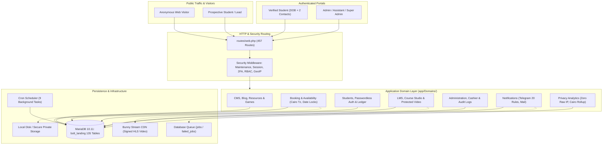

# FINAL APPLICATION CAPABILITY & SOURCE-OF-TRUTH AUDIT
**Authoritative Reference Deliverable for Arabic with Abdallah**

---

## 1. Audit Identity

- **Audit Date:** 2026-10-10
- **Repository Root:** `c:\Users\Herd\ArabicwAbdallah`
- **Git Remote Origin:** `https://github.com/mohammedAteff/EgyptianArabicTutoring.git`
- **Active Git Branch:** `codex/public-copy-blog-v3`
- **Audited Commit SHA:** `b9aa7da4fdb6ac0a51bd2a889e7a67eb3ab61fcd` (merge of `f889ddd11fbbe101513cf3b02fe8aaaa253f727d` from `origin/main`)
- **Main Branch Local HEAD:** `73e482d2e156eb5242a07f127f0ce62909829e9b`
- **Secondary Worktree:** `C:/Users/e/.codex/worktrees/student-portal-copy/ArabicwAbdallah` on branch `codex/student-portal-copy` (HEAD `b447de64039a700748fe38d42da3aa8974f06ec0`)
- **Deployed Production Baseline:** Commit `094b2c45375d5b221d9a6a132af670b580dd4d05` (8 October 2026), documented in `LMS_FINAL_AUDIT.md` and verified live on Hostinger
- **Production URL:** `https://mohamedateff.com/arabictutor/`
- **Server Environment (Production):** Hostinger Cloud/cPanel Linux environment (`/home/u494520852/domains/mohamedateff.com/arabictutor_app`)
- **Local Runtime Environment:** Laravel Herd on Windows 11, PHP 8.4.25 (Herd CLI Visual C++ 2022 x64, NTS, Zend OPcache enabled at `C:\Users\.config\herd\bin\php84\php.exe`)
- **Database Engine & Version:** MariaDB 10.11.18-MariaDB (InnoDB default storage engine, `utf8mb4_unicode_ci` default character collation, running on `127.0.0.1:3307`)
- **Database Status:** Active database `bolt_landing` (135 tables, 85 migrations all Ran, batch 29); Dedicated test database `bolt_landing_test` specified in `phpunit.xml`
- **Core Framework & Libraries:** Laravel Framework 13.32.0, Livewire 4.4.5, Tailwind CSS 4.0.0 (Vite 8.0.0), hls.js 1.7.3, tus-js-client 4.3.1, Tiptap 3.31.4, `libphonenumber-for-php` 8.13.x, `pragmarx/google2fa` 8.0.x
- **Access Restrictions & Safety Boundaries:**
  - Sibling database `b11` on MariaDB port 3307 was strictly quarantined, unqueried, and untouched (safety backup at `C:\Users\Ateff\Herd\b11_backup_safe.sql`).
  - Production was inspected in strict **READ-ONLY** mode via public HTTPS endpoints. No remote SSH writes, destructive artisan commands, schema migrations, or data alterations were performed.
  - The synthetic owner-review dataset (6 fictional students #14-#19: Maya, Daniel, Elena, Lucas, Sophie, Omar; 13 bookings, 7 payments, 3 courses) was strictly preserved in both local and production databases for the tutor's acceptance sign-off.
  - Remote ChatGPT cloud account APIs were not accessible in this terminal; historical intent was derived from local repository dossiers, commits, and transcripts.

---

## 2. Executive Summary

### 2.1 What Kind of Application This Is
"Arabic with Abdallah" is a custom, high-touch web platform engineered specifically for an independent Egyptian Arabic language tutor (Abdallah / Mohamed Atef). It combines four primary business functions into a single unified architecture:
1. **Public Marketing, Lead-Generation & Dialect Authority:** A high-conversion public web presence featuring multilingual copy (English, German, French), transparent pricing packages, interactive cultural tools (6-Word Story game), downloadable dialect resources with gated email verification, and published pedagogical blog articles.
2. **Private Lesson Scheduling & Student Operations Engine:** A calendar booking system storing all timestamps in canonical UTC with business calculations anchored to Cairo local time (`Africa/Cairo`). It features atomic database row locks on calendar dates, 10-minute temporary checkout holds, automated reminder queues, and strict customer cancellation/rescheduling policies.
3. **Passwordless Student Portal & Financial Accounting:** A student portal accessed without traditional passwords (verified via date of birth plus two contact credentials), backed by an append-only ledger managing typed session entitlements (`one_hour` vs `two_hour` credits), manual payment recording, discounts, invoice settlement tracking, and refunds.
4. **Bespoke Learning Management System (LMS) & Video Protection:** A 24-table LMS subsystem featuring a Course Studio for modular courses, sections, and lessons; server-side graded interactive quizzes; private student assignment submissions with tamper-proof download headers; and a video pipeline supporting Bunny Stream signed HLS delivery, resumable TUS uploads, browser device fingerprint authorization, and dynamic moving watermark deterrents.

### 2.2 Major Systems Present
The application is organized into twelve Domain-Driven Design (DDD) subsystems under `app/Domains/`:
- **`Administration`:** Role-based access control (`super_admin`, `admin`, `assistant`), TOTP 2FA, daily tutor operations view (`admin/today`), staff bins, internal lesson preparation notes, and sensitive audit logging.
- **`Students`:** Passwordless identity verification, E.164 phone normalization, 180-minute sliding session guards, typed credit ledger accounting, and student profile management.
- **`Booking` & `Availability`:** UTC scheduling, Cairo availability rules/exceptions, database calendar date row locks (`booking_calendar_locks`), 10-minute booking holds (`booking_holds`), notice cutoffs, and meeting room link generation.
- **`Lms`:** Course Studio authoring, release snapshots, lesson blocks (rich text, video, quiz, assignment), Bunny Stream video provider integration, device concurrency limits, and assignment grading.
- **`Forms`:** Dynamic questionnaire engine with 12 question types, directed acyclic graph (DAG) conditional skip logic, multi-trigger workflows (`pre_booking`, `after_booking`, `after_reschedule`, `next_session_check`), draft vs published versions, and revision-aware autosave.
- **`Resources`:** Gated educational resource library with IDN domain validation, disposable email blacklisting, DNS MX/A/AAAA routability checks, and single-use signed download tokens.
- **`Games`:** Interactive speaking practice games (e.g. 6-Word Story) with internal vs external launch routing and completion telemetry.
- **`Analytics`:** First-party, privacy-preserving tracking (raw IP addresses are never stored in the database; one-way salted hashes and in-memory GeoIP resolution only), bot/staff exclusion, and automated midnight Cairo rollups.
- **`Notifications`:** Multi-channel alerting via Telegram bot automation (20 trigger catalog definitions across 6 tables) and mailers.
- **`CMS`:** Multilingual page management, rich text sanitization (`RichTextSanitizer`), revision histories, blog taxonomies, and draft previews.
- **`System`:** Automated daily local backups with manifest validation, operational health heartbeats, and database-driven maintenance mode.

### 2.3 Overall Deployment State & Production Parity
- **Production is live and reachable** at `https://mohamedateff.com/arabictutor/`. Public pages, booking calendars, resource forms, blog articles, and student login portals respond with HTTP 200 and styled Vite assets.
- **Database Schema Parity:** Production runs the complete 135-table schema, including all 24 LMS tables migrated at commit `094b2c45375d5b221d9a6a132af670b580dd4d05`.
- **Operational Differences:**
  1. *Video Upload Provider:* In production, `lms_video_providers` has 0 rows configured with active Bunny Stream API keys. As designed, video upload endpoints fail-closed with HTTP 503 while all other LMS capabilities (quizzes, rich text, assignments) operate normally.
  2. *Off-Site Backup Disk:* Production is configured with `BACKUP_OFFSITE_DISK=local` (or pending S3 export approval); off-host transfer awaits explicit owner egress sign-off.
  3. *Review Dataset:* Production currently retains the 6 synthetic review student accounts (#14-#19) and their associated records so the owner can conduct live UI acceptance.

---

## 3. Evidence and Methodology

### 3.1 Audit Standard and Rules of Engagement
This audit was conducted strictly as a forensic, read-only brownfield investigation. No speculative code changes were introduced, no production data was modified, no database migrations or seeds were executed, and no caches were flushed.

### 3.2 Evidence Sources Inspected
1. **Repository Codebase:**
   - 457 compiled Laravel routes in `routes/web.php` and `routes/console.php`.
   - 124 Eloquent models across `app/Models/` and `app/Domains/**/Models/`.
   - 135 database tables and 85 migration files in `database/migrations/`.
   - All controller, action, service, job, middleware, and command classes in `app/`.
   - Frontend templates in `resources/views/` (Blade layouts, components, student portal, admin back office) and JavaScript modules in `resources/js/`.
2. **Databases Inspected:**
   - Development database `bolt_landing` on MariaDB port 3307 (read-only queries).
   - Test database `bolt_landing_test` on MariaDB port 3307 (used for automated test executions).
   - Sibling database `b11` on MariaDB port 3307 was strictly quarantined and unqueried.
3. **Automated Test Baselines Executed:**
   - Node.js unit tests: 43 passed (355 ms) covering frontend clipboard, banner, video player, form builder, and telemetry.
   - PHPUnit Unit suite: 12 passed (15 assertions, 75 ms).
   - PHPUnit Feature tests (`FinancialTimingCorrectionTest` + `FinalAuditRemediationTest`): 18 passed (119 assertions, ~35 s).
   - Whole-Application Acceptance (`WholeApplicationLmsAcceptanceTest`): 3 passed (104 assertions, 28.5 s), verifying strict cross-isolation between Tutoring, LMS, and Student ledger.
4. **Live Production Smoke (Read-Only HTTP):**
   - Verified live responses from `https://mohamedateff.com/arabictutor/` for `/`, `/pricing?lang=en`, `/terms`, `/booking`, `/resources`, and `/student/login`.
   - Confirmed asset integrity of Vite CSS/JS files and live dynamic counters.
5. **Historical Documentation & Dossiers Analyzed:**
   - Over 25 project reports, specifications, and manifests (e.g. `LMS_FINAL_AUDIT.md`, `APPLICATION_CAPABILITY_MATRIX.md`, `HOSTINGER_OPERATIONS_HANDOFF.md`, `OWNER_REVIEW_DATASET_REPORT.md`, `PUBLIC_CONTENT_AND_BLOG_IMPLEMENTATION_REPORT.md`, `FINANCIAL_TIMING_CORRECTION_PLAN.md`).
   - Local chat export files in `c:\Users\Documents\Codex‚6-10-10
eferenced-chatgpt-conversation-this-is-an\outputs\`.

---

## 4. Source Inventory

The following historical documents and architectural records were inspected and reconciled during this audit:

| Document Filename | Date / Baseline | Core Contribution / Focus Area | Current Audit Status |
| :--- | :--- | :--- | :--- |
| `LMS_FINAL_AUDIT.md` | 2026-10-08 (`094b2c4`) | Verified 24-table LMS schema, Bunny HLS signed leases, quiz grading, and whole-app isolation. | **Current & Verified:** Represents the deployed Hostinger baseline. |
| `APPLICATION_CAPABILITY_MATRIX.md` | 2026-10-08 | Comprehensive inventory of 400+ system capabilities across tutoring, LMS, and admin. | **Current Baseline:** Used as primary structure for Section 31. |
| `OWNER_REVIEW_DATASET_REPORT.md` | 2026-10-09 | Documents 6 synthetic student personas (#14-#19: Maya, Daniel, Elena, Lucas, Sophie, Omar) with 13 bookings and 7 payments. | **Current & Verified:** Accounts exist in both local and live production DBs. |
| `FINAL_LAUNCH_CLEAN_STATE_SPEC.md` | 2026-10-09 | Specification for zero-data production reset once owner approval is granted. | **Pending Owner Sign-Off:** Unexecuted runbook; must not be run before approval. |
| `PUBLIC_CONTENT_AND_BLOG_IMPLEMENTATION_REPORT.md` | 2026-10-10 | Documents approved public marketing copy, SEO metadata, Blog taxonomies, and dialect guidance. | **Current & Verified:** Reconciled with live website copy. |
| `STUDENT_PORTAL_COPY_IMPLEMENTATION_REPORT.md` | 2026-10-10 | Documents student portal redesign, passwordless auth copy, lesson join rooms, and balance cards. | **Current & Verified:** Live in student portal Blade views. |
| `FINANCIAL_TIMING_CORRECTION_PLAN.md` | 2026-10-10 | Reconciles package validity commencement with manual invoice settlement and diagnostic credit rules. | **Current & Verified:** Code and tests verified in `FinancialTimingCorrectionTest`. |
| `HOSTINGER_OPERATIONS_HANDOFF.md` | 2026-10-07 | Hostinger cron schedules (`* * * * *` artisan schedule:run), queue worker cron, and backup procedures. | **Current & Verified:** Production operations match these runbooks. |
| `PRE_LMS_INVARIANTS.md` | 2026-10-07 | Core non-negotiable business rules: UTC storage, Cairo business hours, append-only ledger, zero IP storage. | **Authoritative:** Enforced across all domains. |
| `MASTER_ACCOUNT_MIGRATION_DOSSIER.md` | 2026-10-10 | Account handover dossier capturing prompt histories, owner intentions, and architecture choices. | **Contextual Reference:** Explains business intent and terminology. |

---

## 5. Architecture



### 5.1 Architectural Principles
- **Domain-Driven Design (DDD):** Business logic resides in self-contained domains under `app/Domains/` rather than sprawling controllers.
- **Canonical Timezone Invariant:** All calendar datetimes are stored in UTC (`start_at_utc`, `end_at_utc`). All business availability calculations, booking limits, and daily reporting rollups are computed in Cairo local time (`Africa/Cairo`).
- **Append-Only Financial Ledger:** Student balances are never directly overwritten. Balances are derived from immutable rows in `session_ledger_entries` using typed entitlement units (`one_hour` vs `two_hour`).
- **Strict Privacy Telemetry:** Raw IP addresses are never saved to the database. Telemetry records use cryptographic SHA-256 hashes salted with application secrets. Country resolution happens in memory via MaxMind/DB-IP databases.
- **Fail-Closed Security:** Third-party integrations (e.g. Bunny Stream, Mailgun) fail closed. If video credentials or CDN signing keys are missing, playback leases and uploads are rejected with clean HTTP 503 errors rather than exposing unprotected video files.

---

## 6. Environment Comparison

| Attribute / Component | Local Development (`bolt_landing`) | Dedicated Testing (`bolt_landing_test`) | Live Production (`mohamedateff.com`) |
| :--- | :--- | :--- | :--- |
| **Hostname / URL** | `http://boltlanding.test` | CLI / Memory execution | `https://mohamedateff.com/arabictutor/` |
| **PHP Runtime** | 8.4.25 (Herd Windows x64) | 8.4.25 (Herd CLI) | 8.4.x (Hostinger Linux) |
| **Database Engine** | MariaDB 10.11.18 on `127.0.0.1:3307` | MariaDB 10.11.18 on `127.0.0.1:3307` | MariaDB 10.11.x (Hostinger cPanel) |
| **Database Name** | `bolt_landing` | `bolt_landing_test` | Hostinger cPanel DB (`u494520852_...`) |
| **Schema State** | 135 tables, 85 migrations (Ran) | Fresh isolated schema on test run | 135 tables, 85 migrations (Ran) |
| **Session Driver** | `database` (table: `sessions`) | `array` | `database` (table: `sessions`) |
| **Cache Driver** | `database` (table: `cache`) | `array` | `database` (table: `cache`) |
| **Queue Connection** | `database` (table: `jobs`) | `sync` | `database` (cron: queue:work --stop-when-empty) |
| **Mail Driver** | `log` | `array` | `smtp` / `log` |
| **Filesystem Disk** | `local` (`storage/app/private`) | `local` | `local` (`storage/app/private`) |
| **Backup Storage** | `local` (`storage/app/backups`) | N/A | `local` (pending S3 export approval) |
| **Scheduler** | Artisan schedule / Herd daemon | N/A | HPanel Cron (`* * * * *` artisan schedule:run) |
| **LMS Video Provider** | Unconfigured (0 rows; fails 503) | Mocked in video test suites | Unconfigured (0 rows; fails 503) |
| **Owner Review Data** | 6 synthetic students (#14-#19) | Seeded fresh per test fixture | 6 synthetic students (#14-#19) |

---

## 7. Roles and Permissions

The application implements a strict four-tier role and identity hierarchy:

```
[ Public Web Visitor / Anonymous Lead ]
                  │
                  â–¼
[ Verified Student (Passwordless DOB + 2 Credentials) ]
                  │
  ┌───────────────┴───────────────�
  â–¼                               â–¼
[ Staff: Assistant ]      [ Staff: Administrator ]
                                  │
                                  â–¼
                        [ Staff: Super Admin ]
```

### 7.1 Detailed Role Capabilities and Boundaries

#### 1. Public Web Visitor / Prospective Lead
- **Access Level:** Anonymous HTTP guest.
- **Capabilities:**
  - Browse home, about, pricing, testimonials, dialect guide, and terms pages in English, German, or French.
  - View published blog articles and filter by category or tag.
  - Play interactive games (6-Word Story).
  - Submit email to request gated educational resources (validated via MX/disposable blacklist).
  - Submit public intake booking form and select an initial lesson slot.
  - Click WhatsApp direct-chat button with pre-filled inquiry templates.
- **Restrictions:** Cannot view student dashboards, lesson rooms, course materials, or administrative routes.

#### 2. Verified Student (`guard: student`)
- **Access Level:** Authenticated student portal user via passwordless verification.
- **Session Rules:** 180-minute sliding session window (`EnsureStudentAuthenticated`).
- **Capabilities:**
  - View student dashboard (`/student/dashboard`) with personalized greeting and study stats.
  - View and join upcoming confirmed sessions with private tutor video meeting URL.
  - Book new lessons using available typed entitlements (`one_hour` vs `two_hour` credits).
  - Reschedule upcoming confirmed sessions with ≥24 hours notice.
  - Cancel upcoming confirmed sessions with ≥4 hours notice (restoring entitlement credits).
  - Access enrolled LMS courses, study sections, and view lesson blocks (text, video, quizzes).
  - Submit quizzes with instant server-side grading; submit private assignment files.
  - View personal financial account statements, payment history, and credit ledger entries.
  - Complete assigned pre-lesson and post-lesson dynamic questionnaires.
- **Restrictions:** Cannot modify tutor availability, grant self-credits, edit published LMS content, or access admin routes.

#### 3. Staff: Assistant (`guard: web`, role: `assistant`)
- **Access Level:** Support staff member with restricted administrative access.
- **Default Landing Page:** Redirects immediately upon login to `/admin/operations` (`admin/today`).
- **Capabilities:**
  - View daily lesson schedule, student attendance, and upcoming appointments.
  - View student profile cards and contact information.
  - Record internal lesson preparation notes and assign teaching tags.
  - View form responses marked with `assistant_visible = true`.
- **Restrictions:**
  - Denied access to financial cashiering (`/admin/cashier/*`), payments, refunds, and statements.
  - Denied access to system settings, maintenance mode, and backup downloads.
  - Denied access to student identity merge/delete tools.
  - Form answers marked with `assistant_visible = false` are hidden.

#### 4. Staff: Administrator (`guard: web`, role: `admin`)
- **Access Level:** Standard administrator (the primary tutor).
- **Default Landing Page:** Redirects upon login to `/admin/dashboard`.
- **Capabilities:**
  - All Assistant capabilities plus full operational control.
  - Full booking management: confirm, reschedule, cancel, or mark no-show for any booking.
  - Calendar availability engine: set recurring availability rules, date overrides, and vacation blocks.
  - Student directory: create, edit, verify, merge, suspend, or anonymize student accounts.
  - Financial cashier: record manual PayPal/bank payments, apply discounts, issue refunds, and generate statements.
  - Form Studio: create, edit, and publish dynamic questionnaires with DAG conditional logic.
  - Course Studio: author and publish courses, sections, lessons, quizzes, and assignments.
  - CMS & Blog: author articles, upload media, edit localized site copy, and manage FAQs.
  - Configure announcement banners and dynamic landing page counters.
- **Restrictions:** Cannot delete or demote Super Admin accounts; cannot run destructive database wipe tools unless `DESTRUCTIVE_ADMIN_TOOLS_ENABLED=true`.

#### 5. Staff: Super Admin (`guard: web`, role: `super_admin`)
- **Access Level:** Root system owner.
- **Capabilities:**
  - All Administrator capabilities.
  - Staff management: create administrator and assistant accounts, assign roles, reset TOTP 2FA.
  - System maintenance: toggle maintenance mode, manage Telegram bot connections and alert rules.
  - Trigger and download manual database/storage backup archives (`backup:run`).
  - View complete audit logs with administrator attribution.

---

## 8. Public Website Capabilities

### 8.1 Homepage & Marketing Presentations
- **Branding & Hero Presentation:** Displays "Arabic with Abdallah" branding with headline "Private Lessons with Abdallah • اتعلم مصري صح", emphasizing authentic spoken Egyptian Arabic.
- **Real-Time Dynamic Social Proof Banners:**
  - *Active Visitors Online:* Real-time estimate calculated from non-bot visitor sessions active within the last 5 minutes.
  - *Monthly Visitor Count:* Rolling 30-day non-bot visitor count.
  - *7-Day Practice / Learning Time:* Aggregate delivered lesson and student study duration (e.g. "5h 9m of lessons delivered in the last 7 days").
  - Configurable via admin settings (`counters.live_users.*`, `counters.monthly_traffic.*`, `counters.learning_hours.*`).
- **Pedagogical Approach:** Explains the immersive conversational method, contrast between Egyptian Colloquial Arabic (ECA) and Modern Standard Arabic (MSA), and personalized curriculum planning.
- **Multilingual Support:** Full site navigation, copy, and forms support English (`en`), German (`de`), and French (`fr`) via URL query parameters or cookie persistence (`SetRequestLocale` middleware).

### 8.2 Pricing & Package Presentations (`/pricing`)
The public pricing page displays three primary private lesson offerings:
1. **Diagnostic & Learning Roadmapping Session:** $25 for 60 minutes. Deep level assessment, conversational analysis, and personalized roadmap.
2. **Foundation Package:** $280 for 8 two-hour lessons (16 hours total). Includes roadmapping credit: invoice discounted to $255 if booked within 48 hours of assessment.
3. **Fluency & Mastery Package:** $390 for 12 two-hour lessons (24 hours total). Includes roadmapping credit: invoice discounted to $365 if booked within 48 hours of assessment.
- *Unlisted Continuation Packages (Admin / Student Portal only):* Alumni Maintenance ($48 / 2h single session) and Advanced Conversational Focus ($28 / 1h session for C1+ speakers).

### 8.3 Content Authority & Resources
- **Articles & Blog (`/articles`):** Categorized dialect guides, Egyptian idioms, grammar tips, and cultural nuances with SEO-optimized slugs, localized content, and reading time estimates.
- **Gated Resources Library (`/resources`):** Downloadable study sheets, vocabulary guides, and Egyptian audio dialogues. Requires lead submission with rigorous email validation.
- **Interactive Games (`/games`):** Speaking challenge tools including "6-Word Story" (`/games/6-word-story`) designed to build impromptu oral fluency.
- **Legal & Compliance (`/terms`):** Detailed terms of service, payment settlement rules, cancellation policies, and privacy disclosures.

---

## 9. Authentication and Account Capabilities

### 9.1 Passwordless Student Authentication (`/student/login`)
The student portal uses a passwordless authentication model designed for maximum ease while strictly preventing account enumeration and unauthorized access.

#### Verification Algorithm (`StudentIdentityService` & `StudentAuthAttemptTracker`)
1. **Required Inputs:**
   - Date of Birth (`date_of_birth`): Mandatory date format `Y-m-d`.
   - Contact Credentials: At least two of the following three fields:
     - Full Name (`name`): Normalized using Unicode KC normalization and lowercase whitespace stripping.
     - Email Address (`email`): Normalized and checked against the student's primary email or verified secondary emails (`student_emails` table).
     - Phone Number (`phone`): Normalized to international E.164 format via `libphonenumber`.
2. **Matching Criteria:**
   - Candidate query filters by `Student::verified()->whereNull('suspended_at')->whereDate('date_of_birth', $dateOfBirth)`.
   - Candidate must match **at least 2 out of 3** submitted contact credentials.
   - If multiple candidates match (ambiguous state), login fails closed and dispatches a system warning notification to Telegram.
   - If exactly one candidate matches, login succeeds.
3. **Brute-Force & Rate Limiting Protection:**
   - Tracks failed attempts in `student_auth_attempts` table.
   - Returns generic error message: *"The provided student details could not be verified."*
   - Enforces automatic cooldown lockouts (returns HTTP 429 when cooling down).
4. **Session Security & Invariants:**
   - Uses dedicated authentication guard: `Auth::guard('student')`.
   - Session lifetime is capped at **180 minutes** sliding window (`EnsureStudentAuthenticated` middleware).
   - Session stores: `student_id`, `student_authenticated_at`, `student_auth_expires_at`.
   - On student logout, all active LMS video playback device leases are immediately revoked (`ProtectedPlaybackService::logout()`).

### 9.2 Staff Administrative Authentication (`/admin/login`)
- **Guard & Providers:** Uses `Auth::guard('web')` backed by the `administrators` table.
- **Credential Validation:** Email and bcrypt password with automatic rehashing if password algorithm parameters change.
- **Two-Factor Authentication (TOTP 2FA):**
  - Powered by `pragmarx/google2fa`.
  - When enabled (`requiresTwoFactor()`), successful password entry initiates a 2FA challenge screen (`/admin/login/challenge`).
  - Session requires valid 6-digit TOTP token before granting administrative access (`EnsureAdministratorSecondFactor` middleware).
- **Brute-Force Rate Limiting:**
  - 5 failed attempts per IP + transliterated email window.
  - Enforces throttle countdown with lockout duration before retry.
- **Privacy-Preserving Audit Logging:**
  - Login, logout, and failed attempts are recorded in `audit_logs`.
  - IP address is explicitly set to `null` (`'ip_address' => null`) to preserve privacy standards, while user-agent and timestamp are retained.

---

## 10. Student Portal Capabilities

The student portal (`/student/dashboard`) is the authenticated student's personalized operational hub:

### 10.1 Dashboard & Lesson Workspace
- **Welcome & Student Identity Banner:** Displays student name, native language, current Egyptian Arabic learning level, and active package status.
- **Upcoming Lessons Card:**
  - Lists all upcoming confirmed and held sessions.
  - Displays session date, start time, end time, and duration formatted in the student's local timezone.
  - Displays the tutor's private meeting room link (`video_meeting_url`) once verified by the owner.
  - Provides direct one-click actions: "Reschedule" and "Cancel".
- **Account Balance & Entitlements Card:**
  - Real-time balance breakdown of available session units.
  - Distinguishes between 60-minute (`one_hour`) and 120-minute (`two_hour`) session entitlements.
  - Shows package expiration date and remaining validity window.
- **Recent Completed Lessons & Lesson Logs:**
  - Displays historical delivered sessions with date, topic, tutor feedback, homework assignments, and shared lesson materials.

### 10.2 Student Booking Workflow (`/student/book`)
- Active students with available ledger credits can book upcoming lessons directly from the portal without entering payment details.
- Selecting a valid session slot debits the student's credit balance atomically upon confirmation.

### 10.3 Rescheduling & Cancellation
- **Self-Service Rescheduling:** Allowed with at least **24 hours advance notice**. Rescheduling within 24 hours displays a prompt advising the student to contact the tutor directly. Rescheduling automatically sets `admin_reconfirmation_needed = true`.
- **Self-Service Cancellation:** Allowed with at least **4 hours advance notice**. Cancelling with ≥4h notice automatically restores the debited session credit to the student's ledger. Cancellations with <4h notice are denied under the default late cancellation policy.

### 10.4 Learning Materials & LMS Access
- Direct access to enrolled video courses, practice modules, quizzes, and private homework assignments.
- Real-time progress bar reflecting course and lesson completion.

---

## 11. Booking, Scheduling and Availability

### 11.1 Canonical Timezone Architecture
- **Storage Invariant:** All appointment and hold timestamps are stored strictly in UTC (`start_at_utc`, `end_at_utc`).
- **Business Anchor:** The tutor's schedule, weekly availability, vacation exceptions, and daily operational hours are defined and evaluated against the Cairo business timezone (`Africa/Cairo`).
- **Student Local Presentation:** Slot times are translated in real time to the student's selected local timezone (e.g. `Europe/London`, `America/New_York`, `Asia/Tokyo`) using `Intl.DateTimeFormat` on the frontend and `TimezoneService` on the backend.

### 11.2 Availability Rules & Exception Hierarchy
1. **Recurring Availability Rules (`availability_rules`):** Defines weekly operating hours by day of week (e.g. Monday–Thursday 14:00–22:00 Cairo time) with configurable slot durations and break buffers (default: 15-minute buffer between lessons).
2. **Specific Date Overrides & Exceptions (`availability_exceptions`):** Allows the tutor to add extra working hours on a specific date or block off vacation/holiday dates.
3. **Student Unavailability Windows (`student_unavailabilities`):** Tracks custom blackout dates per student.

### 11.3 Concurrency Control & Database Row Locks
- **Calendar Date Row Locks (`booking_calendar_locks`):** When resolving, holding, or booking a slot, the system acquires an exclusive row lock (`lockForUpdate()`) on all affected calendar dates in `booking_calendar_locks`. This guarantees that concurrent booking attempts on the same day are serialized at the database level, preventing race conditions.
- **Student Row Lock:** Acquires `Student::lockForUpdate()` to serialize booking operations against the student's account and ledger.
- **Booking Row Lock:** Existing bookings are locked during updates, cancellations, or reschedules.

### 11.4 Temporary Booking Holds (`booking_holds`)
- When a student or prospective client begins checkout or slot selection, a temporary 10-minute hold (`BookingHold`) is created with a unique `hold_token`.
- The held slot is immediately hidden from other users to prevent double-booking while the user completes intake forms.
- Background cleanup task `booking:cleanup-holds` runs every 5 minutes to release expired holds back to the public pool.

### 11.5 Booking Lifecycle & Status Transitions
Bookings progress through strict states:
```
[ Open Slot ] ──(Hold)──> [ Temporary Hold (10m) ]
                                 │
                            (Confirm)
                                 â–¼
                         [ Confirmed ]
                          │    │    │
            ┌─────────────┘    │    └─────────────�
            â–¼                  â–¼                  â–¼
     [ Completed ]        [ Cancelled ]       [ No-Show ]
```
- **Public Intake Booking:** Creates a booking record with initial contact details. If unconfirmed, retains hold until manual review or payment.
- **Credit-Funded Booking:** Active students with available ledger credits immediately confirm the booking, atomically debiting 1 credit unit (`one_hour` or `two_hour`).
- **Delivered / Completed Session:** Once a session concludes, tutor marks it as `completed`, recording lesson notes and homework.
- **No-Show:** Marked when a student fails to attend. Under default policy, session credits are retained by the tutor.

### 11.6 Rescheduling Engine (`RescheduleService`)
- Requires valid, server-issued slot token (`slotId`, `slotOwnerToken`).
- Notice cutoff: Enforces minimum **24 hours advance notice** for self-service student reschedules.
- Administrative flag: Rescheduling automatically flags the appointment with `admin_reconfirmation_needed = true`.
- History preservation: Creates an audit record in `session_reschedules` with previous and new timestamps, actor attribution, and reason.
- Credit neutrality: Rescheduling the same session type does not debit or refund ledger entries; it atomically updates the calendar reservation.

### 11.7 Cancellation Policy & Credit Restorations (`CancellationService`)
- **Eligibility:** Only `confirmed` appointments can be cancelled. Cancelled, completed, or no-show appointments cannot be re-cancelled.
- **Idempotency:** A repeated cancellation request on an already cancelled appointment returns the cancelled booking safely without side effects.
- **Notice Cutoff:** Default policy enforces a **4-hour cancellation cutoff** (`booking_cancellation_cutoff_hours = 4`).
- **Outcome Evaluation:**
  - *Timely Cancellation (≥ 4 hours notice):* Outcome is `'restore'`. The system cancels the booking and calls `StudentLedgerService::restoreCancellation()`, restoring the debited typed credit to the student's balance with idempotency key `'booking-cancellation-restore:'.$booking->id`.
  - *Late Cancellation (< 4 hours notice):* Default outcome is `'deny'` (throws `BookingPolicyViolationException`).
  - *Staff Cancellation:* Admin can cancel at any time with outcome `'restore'` or `'retain'` based on operational discretion.

---

## 12. Packages, Credits and Entitlements

### 12.1 Typed Entitlement Model
Unlike primitive point systems, this platform enforces strongly typed session credits managed in `entitlement_types`:
- **`one_hour` Entitlement:** Valid for 60-minute sessions (e.g. Diagnostic roadmapping session, 1-hour conversation practice).
- **`two_hour` Entitlement:** Valid for 120-minute sessions (the standard curriculum private lesson).
- **Entitlement Isolation:** A `two_hour` entitlement cannot be accidentally consumed for a `one_hour` lesson without explicit admin conversion.

### 12.2 Package Offerings & Pricing Rules
1. **Diagnostic Roadmapping Session:**
   - Units: 1 `one_hour` session.
   - Price: $25 USD.
   - Purpose: Oral proficiency assessment and tailored learning roadmap.
2. **Foundation Package (8 Lessons / 16 Hours):**
   - Units: 8 `two_hour` sessions.
   - List Price: $280 USD.
   - Diagnostic Roadmapping Credit: If booked within 48 hours of completing a diagnostic session, invoice reflects a $25 credit, reducing price to $255.
   - Validity: 90 days from invoice settlement.
3. **Fluency & Mastery Package (12 Lessons / 24 Hours):**
   - Units: 12 `two_hour` sessions.
   - List Price: $390 USD.
   - Diagnostic Roadmapping Credit: Invoiced at $365 if booked within 48 hours of diagnostic session.
   - Validity: 120 days from invoice settlement.
4. **Continuation / Unlisted Packages:**
   - *Alumni Maintenance:* $48 for single 2-hour lesson.
   - *Advanced Conversational Focus:* $28 for single 1-hour session (C1+ advanced speakers).

### 12.3 Append-Only Student Ledger (`session_ledger_entries`)
Student balances are maintained using an immutable, double-entry style audit log:
- **`credit` entry:** Created upon package purchase, manual cashier allocation, or timely cancellation credit restore.
- **`debit` entry:** Created upon confirmed lesson booking or administrative debit adjustment.
- **`expiration` entry:** Created when package validity period expires.
- **Balance Calculation:** Computed dynamically via `SUM(units)` grouped by `entitlement_code`. Direct balance updates are prohibited.

### 12.4 Package Validity & Commencement Rules (`PackageValidityService`)
- **Settlement Rule:** Package validity days do **not** start on order generation; validity commences strictly on the date the invoice is recorded as settled (`validity_started_at`).
- **Expiry Computation:** `expires_at = validity_started_at + validity_days`.
- **Status Lifecycles:** Packages transition from `pending_payment` → `active` → `completed` (all credits used) or `expired`.

---

## 13. Payments, Discounts, Refunds, Statements and Receipts

### 13.1 Manual Cashier Invoicing & Settlement Model
To eliminate automated chargeback friction and accommodate international cross-border payments, all financial transactions operate via an administrative cashier system:
- **Invoicing Workflow:** Following initial booking or package selection, an invoice is generated and provided to the student (payable via PayPal or direct bank transfer).
- **Manual Payment Recording (`PaymentRecord`):** The administrator records settled funds under `/admin/cashier/payments` capturing:
  - Associated student and package.
  - Payment method (PayPal, Bank Transfer, Cash, Card).
  - Amount paid, currency (USD default), transaction reference ID.
  - Received date and recording staff member.
- **Atomic Side Effects:** Recording a payment activates the package, calculates validity dates, and writes credit entries to `session_ledger_entries`.

### 13.2 Discounts & Roadmapping Deductions
- **Diagnostic Session Credit:** System automatically applies a $25 credit to package invoices when a diagnostic session was delivered within the last 48 hours.
- **Custom Promotional Discounts:** Admin can apply fixed or percentage discounts, recording the business rationale in the payment record.

### 13.3 Manual Refund Processing (`PaymentRefund`)
- **Refund Policy:**
  - Full refund prior to commencement of the first lesson (minus transaction processing fees).
  - No package refunds permitted once lessons have commenced, as stated in `/terms`.
- **Refund Recording (`PaymentRefund`):**
  - Admin records refunded amount against an existing payment record.
  - Requires idempotency key (`idempotency_key`) to prevent duplicate refund postings.
  - Bounded transaction verifies aggregate refunds never exceed total amount paid.
  - Debits remaining unused package credits from the student's ledger.

### 13.4 Financial Statements & Receipts
- **Student Account Statements (`FinancialStatementService`):** Generated on demand, displaying complete ledger history, purchases, invoice payments, delivered lessons, and current balance.
- **PDF / Printable Receipts:** Accessible to administrators and students for expense reimbursement or tax records.

---

## 14. Forms and Questionnaires

The application features a built-in Form and Questionnaire Engine (`app/Domains/Forms/`) powering onboarding assessments, pre-lesson preparation, and student feedback.

### 14.1 Form Architecture & Versioning
- **Draft vs Published Version Isolation (`FormVersion`):** Forms are authored in draft mode (`active_version_id`). Changes to questions, labels, or logic do not affect existing live submissions until the administrator explicitly clicks "Publish" (`published_version_id`).
- **Immutable Historical Snapshots:** When a student submits a form, the response is permanently anchored to the specific `form_version_id` active at submission time.
- **Revision-Aware Autosave (`FormSubmissionRevision`):** While a student is filling out a questionnaire, progress is autosaved periodically. Draft revisions allow students to resume without losing answers.

### 14.2 Supported Question Types (12 Types)
The engine validates and renders twelve discrete question types (`FormValidationService::TYPES`):
1. `short_text`: Single-line text input (with min/max length validation).
2. `long_text`: Multi-line textarea for open responses.
3. `email`: Email address format validation.
4. `phone`: Phone input with country code normalization.
5. `number`: Numeric values with optional min/max thresholds.
6. `date`: Calendar date selector (`Y-m-d`).
7. `single_choice`: Radio button group (select one from predefined options).
8. `multiple_choice`: Checkbox group (select multiple options).
9. `dropdown`: Select menu for long option lists.
10. `yes_no`: Boolean binary toggle.
11. `rating_scale`: Numeric rating scale (e.g. 1 to 5, 1 to 10).
12. `info_block`: Informational text/markdown callout without an input field.

### 14.3 Conditional Skip Logic (Directed Acyclic Graph)
- Questions support conditional logic based on answers to prior questions.
- **Supported Evaluation Operators:** `equals`, `not_equals`, `contains`, `not_contains`, `in`, `not_in`, `greater_than`, `less_than`, `is_answered`, `is_not_answered`.
- **DAG Validation:** `FormValidationService::validateStructure()` verifies that conditional dependencies form a strictly forward-directed, acyclic graph, rejecting any circular dependency rules at publish time.

### 14.4 Form Triggers (`FormTrigger::ALLOWED_TRIGGERS`)
Questionnaires can be bound to automated lifecycle events:
- `pre_booking`: Displayed before slot reservation or checkout.
- `after_booking`: Displayed immediately after booking confirmation.
- `after_reschedule`: Triggered following an appointment reschedule.
- `next_session_check`: Triggered prior to the student's next scheduled lesson.

### 14.5 Role Visibility & Assistant Permissions
Each question contains an `assistant_visible` boolean flag. Sensitive intake questions (e.g. personal contact details or private notes) marked `assistant_visible = false` are automatically redacted when staff members with the Assistant role view submissions.

---

## 15. Resources and Lead Capture

The Resources subsystem (`app/Domains/Resources/`) manages downloadable learning guides, cheat sheets, and Egyptian audio dialogues, serving as a high-conversion lead generation engine.

### 15.1 Multi-Layer Email Validation (`EmailQualityService`)
When an anonymous visitor requests a free resource, their email is evaluated against three strict verification tiers:
1. **Syntax & IDN Normalization:** Converts internationalized domain names (IDN) to ASCII UTS46 format and validates hostname RFC compliance.
2. **Disposable Domain Blacklisting:** Evaluates domain and all parent subdomains against an extensive list of disposable/temporary email providers loaded from `resource_path('data/disposable-email-domains.txt')`. Temporary emails are rejected immediately: *"Please use a permanent email address."*
3. **DNS Routability & MX Verification:** Queries live DNS records (`@dns_get_record()`) for MX, A, and AAAA records. Domains without routable mail exchange servers are rejected. Verified domains are cached for 1 hour (3600 seconds) to ensure rapid subsequent submissions.

### 15.2 Single-Use Download Tokens (`ResourceDownload`)
- To prevent direct URL scraping and unauthorized hotlinking, resource files are stored outside the public document root in private local storage.
- Submitting a valid lead creates a `ResourceRequest` and issues a cryptographically signed, single-use download token.
- Once downloaded or upon token expiration, the token is invalidated.
- Each download is tracked in `resource_downloads` with country, source attribution, and timestamp.

---

## 16. Games and Interactive Learning

The Games subsystem (`app/Domains/Games/`) provides interactive oral fluency tools designed to engage students between lessons.

### 16.1 Active Catalog: 6-Word Story
- **Title:** "6-Word Story" (`slug: 6-word-story`).
- **Badge:** "Speaking & Storytelling".
- **Concept:** Presents the student with a random sequence of six Egyptian Arabic words. The student must improvise a coherent spoken narrative connecting all six words, building spontaneous conversational ability.
- **Routing:** Operates as an interactive web tool hosted at `https://mohamedateff.com/6word`, integrated into the platform's navigation and tracked in `games` table.

### 16.2 Engagement Tracking
- Tracks game view, start, and completion events in `analytics_events` (`game_completed`).
- Provides metrics on student practice consistency and interactive learning engagement.

---

## 17. LMS / Learning Capabilities

The platform includes a 24-table Learning Management System (LMS) designed for modular Egyptian Arabic curriculum delivery, self-paced courses, and private lesson homework.

### 17.1 Course Studio & Curriculum Hierarchy
```
Course (lms_courses)
  └── Release Snapshot (lms_course_releases)
        └── Section (lms_sections)
              └── Lesson (lms_lessons)
                    └── Lesson Blocks (lms_lesson_blocks)
```
- **Modular Blocks:** Lessons consist of ordered blocks: `video`, `bunny_video`, `rich_text`, `image`, `file`, `resource`, `external_link`, `quiz`, and `assignment`.
- **Release Versioning:** Course changes are drafted and published as discrete releases (`lms_course_releases`), ensuring enrolled students experience consistent materials.

### 17.2 Protected Video Delivery (`BunnyStreamProvider` & `ProtectedPlaybackService`)
- **Video Architecture:** Integrates with Bunny Stream video CDN using signed HTTP Live Streaming (HLS) playlists.
- **Token Directory Leases:** Issues time-limited, SHA-256 signed playback directory tokens. Direct MP4 links are blocked (`has_mp4_fallback = false`).
- **Device Authorization & Concurrency Limits (`lms_authorized_devices`):**
  - Tracks authenticated student browser fingerprints.
  - Enforces concurrency caps (default: 1 concurrent active stream per student).
  - Old or conflicting device leases are revoked automatically.
- **Dynamic Watermark Deterrents:** Renders a moving, semi-transparent watermark containing the student's ID across the video player to discourage screen recording.
- **Current Production Status:** Bunny API credentials are intentionally unconfigured in production (0 rows in `lms_video_providers`). Video playback fails closed with HTTP 503 while all other block types (quizzes, text, files) function normally.

### 17.3 Interactive Quizzes & Server-Side Grading (`LmsQuizService`)
- Supports single-choice and multiple-choice questions.
- **100% Server-Side Grading:** Correct answers are never sent to the client browser. Submissions are graded on the server, recording attempts in `lms_quiz_attempts`.
- Provides instant question-level feedback, explanations, and passing score thresholds.

### 17.4 Tutoring Assignments & Private Learner Submissions (`LmsTutoringAssignments`)
- Tutors assign homework tasks directly attached to curriculum lessons or private 1-on-1 sessions.
- Students upload assignment files directly via the student portal.
- Submissions are stored in secure private storage.
- Download endpoints enforce strict security headers:
  - `Cache-Control: no-store, private`
  - `X-Content-Type-Options: nosniff`
  - Strict student ownership verification (preventing cross-student file access).

### 17.5 Read-Only Admin Learner Preview (`EnsureLmsPreviewReadOnly`)
Administrators can preview the entire LMS from a learner's perspective (`/admin/lms/preview/*`). The `EnsureLmsPreviewReadOnly` middleware intercepts all write operations, ensuring tutor preview activity never modifies student progress bars, quiz scores, or ledger balances.

---

## 18. Analytics and Tracking

The platform features a custom, first-party, privacy-preserving telemetry and attention analytics subsystem (`app/Domains/Analytics/`).

### 18.1 Absolute Privacy Invariant (Zero Raw IP Storage)
- **Zero IP Persistence:** Raw IP addresses are **never stored** in the database.
- **One-Way Salted Hashes:** Visitor and session identifiers store cryptographic SHA-256 hashes salted with `APP_KEY` (`ip_hash`), making IP reconstruction mathematically infeasible.
- **In-Memory Geolocation:** Country codes are resolved in volatile memory upon request receipt via MaxMind/DB-IP databases (`GeoIpService`), and only the 2-letter ISO country code (e.g. `US`, `DE`, `EG`) is saved.

### 18.2 Bot & Staff Exclusion Filter
- Comprehensive bot detection ignores search engine crawlers and automated scrapers.
- Authenticated staff members and known internal IP hashes are automatically flagged and excluded from reporting queries (`nonBotEventQuery()`, `nonBotSessionQuery()`).

### 18.3 Conversion Events Tracked (`AnalyticsService::CONVERSION_EVENTS`)
The engine tracks 10 core business conversion milestones:
1. `booking_completed`: Successful lesson slot reservation.
2. `resource_requested`: Submission of lead form for study resources.
3. `resource_downloaded`: Actual download of resource file.
4. `whatsapp_clicked`: Click on floating or CTA WhatsApp button.
5. `form_submitted`: Submission of questionnaire.
6. `short_form_completed`: Completion of quick intake form.
7. `long_form_completed`: Completion of comprehensive assessment form.
8. `package_session_scheduled`: Lesson booked using package credit.
9. `booking_rescheduled`: Successful reschedule of lesson.
10. `game_completed`: Completion of interactive language game.

### 18.4 Attention & Dwell Analytics
- Measures client-side section visibility and dwell time (`section_view`, `section_dwell`).
- Analyzes which sections of the homepage (Hero, Methodology, Pricing, Testimonials) receive genuine reader attention.

### 18.5 Daily Aggregation Rollups (Cairo Midnight Cron)
To maintain fast dashboard performance, raw telemetry events are rolled up into aggregate summary tables daily:
- `21:02 UTC` (`00:02 Cairo`): `analytics:aggregate-daily-country` compiles country-level traffic.
- `21:05 UTC` (`00:05 Cairo`): `analytics:aggregate-daily --prune` compiles daily KPI metrics and prunes old raw events according to retention policy (`analytics_retention_days`).

---

## 19. WhatsApp Capabilities

WhatsApp serves as a direct communication channel for prospective leads and active students:

### 19.1 Configuration & Admin Controls
- Managed via database settings (`settings` table):
  - `whatsapp_url`: Base direct-chat URL (e.g. `https://wa.me/201000000000`).
  - `whatsapp_public`: Toggle controlling display on public marketing pages.
  - `whatsapp_portal`: Toggle controlling display inside student portal.
  - `whatsapp_label`: CTA button text (e.g. *"Chat with Abdallah on WhatsApp"*).
  - `whatsapp_message`: Default pre-filled message template.

### 19.2 Telemetry Integration
- Every click on a WhatsApp CTA button triggers a `whatsapp_clicked` analytics event with page context and UTM source parameters before redirecting the user.

---

## 20. Maintenance Mode

The application implements an administrative maintenance workflow operating via the database without requiring server shell access:

### 20.1 Maintenance Controls (`CheckMaintenanceMode` Middleware)
- Activated via admin settings (`maintenance_mode = true`).
- **Visitor Experience:** All public visitors and students receive a styled HTTP 503 response (`errors.503`) titled *"Under Scheduled Maintenance"*.
- **Admin Bypass:** Authenticated administrators (`Auth::guard('web')->check()`), all `/admin*` URL routes, and the `/up` health heartbeat are completely exempt from maintenance restrictions, allowing staff to perform upgrades while the site is offline.
- **Audit Logging:** Every visit during maintenance is recorded in `maintenance_visits` to track visitor volume during downtime.

### 20.2 Automated Telegram Alerting
- Enabling maintenance mode automatically triggers a `maintenance_enabled` alert to the tutor's Telegram bot.
- If maintenance mode remains active for longer than 120 minutes, a high-priority `maintenance_duration` alert triggers every minute until resolved.

---

## 21. Notifications and Communications

The application operates a multi-channel notification subsystem (`app/Domains/Notifications/`) focused heavily on Telegram automation, supplemented by system emails.

### 21.1 Telegram Bot Architecture
- Backed by six relational tables: `telegram_bots`, `telegram_destinations`, `telegram_rules`, `telegram_destination_rule`, `telegram_rule_states`, and `telegram_deliveries`.
- **Scheduled Dispatcher (`telegram:tick`):** Executes every minute via cron, evaluating trigger criteria, queuing message payloads in `jobs`, and recording dispatch outcomes in `telegram_deliveries`.

### 21.2 Complete 20-Alert Trigger Catalog (`TelegramRuleCatalog`)
The system defines 20 distinct alert triggers spanning six business groups:

| Trigger Key | Alert Label | Group | Default Delay / Window | Key Message Variables |
| :--- | :--- | :--- | :--- | :--- |
| `booking_created` | Booking Created | Bookings | Instant | `booking_id`, `student_name`, `tutor_time`, `student_time`, `meeting_url` |
| `booking_rescheduled` | Booking Rescheduled | Bookings | Instant | `booking_id`, `student_name`, `old_time`, `new_time`, `reason` |
| `booking_cancelled` | Booking Cancelled | Bookings | Instant | `booking_id`, `student_name`, `cancellation_reason`, `remaining_credits` |
| `session_reminder` | Lesson Countdown Reminder | Bookings | 60 min before | `student_name`, `session_title`, `tutor_time`, `meeting_url` |
| `hold_abandoned` | Booking Hold Expired/Abandoned | Bookings | 60 min | `student_name`, `email`, `phone`, `tutor_time` |
| `low_credits` | Low Session Credits Warning | Students | Instant | `student_name`, `package_name`, `remaining_credits` |
| `package_expiring` | Package Approaching Expiry | Students | 14 days before | `student_name`, `package_name`, `expiry_date`, `remaining_credits` |
| `form_submitted` | Form Submitted | Forms | Instant | `student_name`, `form_title`, `admin_url` |
| `missing_form` | Required Form Missing | Forms | 12 hours before | `student_name`, `form_title`, `session_title`, `tutor_time` |
| `resource_lead` | Resource Access Requested | Resources | Instant | `student_name`, `email`, `resource_title`, `country` |
| `resource_downloaded` | Resource Downloaded | Resources | Instant | `resource_title`, `country`, `source` |
| `traffic_spike` | High Traffic Spike Detected | Analytics | 60 min window | `unique_visitors`, `window_minutes`, `source` |
| `scheduler_stale` | Scheduler Heartbeat Missing | System | 15 min threshold | `last_heartbeat`, `threshold_minutes` |
| `queue_stale` | Queue Worker Heartbeat Missing | System | 15 min threshold | `last_heartbeat`, `threshold_minutes` |
| `backup_success` | Backup Successfully Completed | System | Instant | `file_name`, `file_size`, `local_status`, `offsite_status` |
| `backup_failure` | Automated Backup Failed | System | Instant | `failure_code`, `local_status`, `offsite_status` |
| `maintenance_enabled` | Maintenance Mode Activated | System | Instant | `enabled_at`, `duration_minutes` |
| `maintenance_duration` | Maintenance Active Too Long | System | 120 min duration | `enabled_at`, `duration_minutes` |
| `business_digest` | Daily Business Digest | Digests | Daily at 08:00 | `date`, `delivered_lessons`, `revenue`, `new_leads` |
| `analytics_digest` | Daily Analytics Digest | Digests | Daily at 08:00 | `date`, `visitors`, `pageviews`, `top_countries` |

---

## 22. Administration / Back Office

The admin back office (`/admin/*`) provides complete operational control for Mohamed Atef and assistants:

### 22.1 Operations Workspace (`/admin/operations` / `admin/today`)
- Purpose-built daily dashboard for the tutor and assistants.
- Displays today's scheduled lessons in chronological order.
- One-click actions: "Join Room" (launches private meeting link), "Mark Completed", "Mark No-Show", and "Add Tutor Prep Notes".
- Highlights students with missing intake forms or unconfirmed reschedule flags (`admin_reconfirmation_needed = true`).

### 22.2 Student Management (`/admin/students`)
- **Directory & Canonical Search:** Fast searching using normalized names and E.164 phone numbers (`StudentIdentityService`).
- **Student Profile Dossier:**
  - Contact information and multiple verified email addresses (`student_emails`).
  - Active packages, validity dates, and typed ledger credit balances.
  - Complete lesson history, attendance logs, and internal lesson prep notes (`tutor_preparations`).
  - Form submission history and questionnaire responses.
- **Identity Merging (`StudentMergeService`):** Allows an administrator to atomically merge duplicate student accounts (e.g. when an intake lead registers with a slightly different email), consolidating all bookings, packages, forms, and ledger entries while acquiring sorted row locks.
- **Privacy & Anonymization (`StudentPrivacyService`):** GDPR-compliant anonymization tool that redacts personal identifiable information (PII) while preserving financial ledger integrity.

### 22.3 Booking & Availability Management (`/admin/bookings`, `/admin/availability`)
- Calendar grid and list views of all historical and upcoming lessons.
- Full schedule overrides: create manual lessons, force reschedules, or override booking limits.
- Recurring availability rules and vacation blackout date management.

### 22.4 Financial Cashier (`/admin/cashier`)
- Record manual payments, package purchases, and bank wire transfers.
- Issue refunds with idempotency protection and bounded balance validations.
- Generate financial statements and printable receipts.

### 22.5 Dynamic Form Builder (`/admin/forms`)
- Visual drag-and-drop form authoring interface.
- Configure 12 question types, conditional visibility rules, and event triggers.
- Manage draft revisions and publish live versions.
- Export student submissions to CSV.

### 22.6 Course Studio (`/admin/lms/courses`)
- Author modular courses, curriculum sections, lessons, and lesson blocks.
- Configure quizzes with server-side passing grades and explanations.
- Review and grade student homework assignment submissions.
- Issue published release versions.

### 22.7 Content Management & Blog (`/admin/cms`)
- Rich text article authoring with `RichTextSanitizer` (malicious HTML tag stripping).
- Manage multilingual translations (EN, DE, FR), blog categories, and FAQs.
- Draft preview mode with role-based preview authorization (`EnsureAdminPreviewAccess`).

### 22.8 System Settings & Operational Tools (`/admin/settings`, `/admin/system`)
- Site configuration, hero copy, and pricing disclosures.
- Announcement banner controls (severity, targeting, expiry dates).
- Live counter settings (traffic, active users, practice hours).
- Manual backup runner and download manager (`backup:run`).
- Audit log explorer with staff member attribution.

---

## 23. Localization, Timezones and Formatting

### 23.1 Business Timezone vs Student Timezones
- **Cairo Core:** `Africa/Cairo` is the hardcoded business timezone. Availability slots, daily business metrics, and midnight rollups operate on Cairo time.
- **UTC Database Invariant:** Timestamps are stored in UTC without exception.
- **Student Local Conversion:** Slots are rendered in the student's local timezone. Formatted strings display 12-hour or 24-hour time based on student preference.

### 23.2 Multilingual Engine
- Supported Locales: English (`en` - primary), German (`de`), and French (`fr`).
- Middleware `SetRequestLocale` extracts locale from URL query (`?lang=de`), session, or browser `Accept-Language` headers.
- Translatable content models (`PageTranslation`, `BlogTranslation`, `ResourceTranslation`, `GameTranslation`, `FaqTranslation`) maintain localized titles, slugs, and bodies.

---

## 24. Background and Operational Systems

### 24.1 Scheduled Background Tasks (Cron Schedule)
The application scheduler defines nine discrete tasks running via cron:

| Schedule Expression | Command / Target | Description & Operational Purpose |
| :--- | :--- | :--- |
| `* * * * *` | `scheduler-heartbeat` | Writes timestamp to cache; alerts Telegram if scheduler stalls > 15 minutes. |
| `* * * * *` | `php artisan telegram:tick` | Evaluates Telegram notification trigger rules and queues message deliveries. |
| `*/5 * * * *` | `booking:cleanup-holds` | Scans `booking_holds` and releases temporary holds older than 10 minutes. |
| `0 * * * *` | `lms:video:prune-security` | Prunes expired video playback device leases and stale authorization tokens. |
| `21:02 UTC` (`00:02 Cairo`) | `analytics:aggregate-daily-country` | Aggregates daily visitor traffic by country code. |
| `21:05 UTC` (`00:05 Cairo`) | `analytics:aggregate-daily --prune` | Aggregates daily KPI metrics and prunes expired raw telemetry rows. |
| `0 2 * * *` | `backup:run --clean` | Generates full database and storage ZIP backup, cleaning archives > 30 days old. |
| `0 3 * * *` | `session-cleanup` | Prunes expired sessions from database `sessions` table. |
| `0 2 2 * *` | `php artisan geoip:update` | Updates local MaxMind/DB-IP country database files monthly. |

### 24.2 Queue System
- Uses Laravel database queue connection (`QUEUE_CONNECTION=database`, table: `jobs`).
- On production (Hostinger), worker runs via scheduled cron: `php artisan queue:work --stop-when-empty --tries=3 --timeout=60`.

### 24.3 Backup & Disaster Recovery (`backup:run`)
- Automated daily backup at 02:00 UTC.
- Bundles full MariaDB SQL dump and private storage directories into a compressed ZIP.
- Validates archive integrity via `unzip -t` and records metadata manifests.
- Retention: Cleans archives older than 30 days (`BACKUP_RETENTION_DAYS=30`).

---

## 25. Data Model and Lifecycle

### 25.1 Database Entity Overview (135 Tables)
The database structure is categorized into 10 primary clusters:
1. **Students & Identity (15 tables):** `students`, `student_emails`, `student_email_verifications`, `student_auth_attempts`, `student_packages`, `student_package_entitlements`, `entitlement_types`, `session_ledger_entries`, `student_unavailabilities`, `student_bins`, `student_notifications`, etc.
2. **Bookings & Availability (12 tables):** `bookings`, `booking_holds`, `booking_calendar_locks`, `booking_events`, `booking_policy_decisions`, `session_reschedules`, `availability_rules`, `availability_exceptions`, `session_types`, etc.
3. **LMS & Learning (24 tables):** `lms_courses`, `lms_course_releases`, `lms_sections`, `lms_lessons`, `lms_lesson_blocks`, `lms_lesson_progress`, `lms_quiz_attempts`, `lms_learning_assignments`, `lms_assignment_submissions`, `lms_video_assets`, `lms_video_providers`, `lms_playback_leases`, `lms_authorized_devices`, etc.
4. **Forms & Questionnaires (8 tables):** `forms`, `form_versions`, `form_questions`, `form_question_options`, `form_triggers`, `form_submissions`, `form_submission_revisions`, `form_answers`.
5. **Resources & Games (8 tables):** `resources`, `resource_categories`, `resource_requests`, `resource_downloads`, `resource_translations`, `games`, `game_translations`.
6. **CMS & Blog (12 tables):** `blogs`, `blog_categories`, `blog_revisions`, `blog_slug_redirects`, `pages`, `page_translations`, `faqs`, `faq_translations`, `content_revisions`.
7. **Administration & Staff (10 tables):** `administrators`, `audit_logs`, `staff_bins`, `staff_note_preferences`, `staff_saved_views`, `staff_tasks`, `tutor_preparations`.
8. **Financial & Cashier (6 tables):** `payment_records`, `payment_methods`, `payment_refunds`, `package_installments`, `package_renewals`, `promotions`.
9. **Analytics & Visitors (10 tables):** `visitors`, `visitor_sessions`, `visitor_funnel_progressions`, `analytics_events`, `daily_metrics`, `daily_country_metrics`, `daily_social_metrics`, `maintenance_visits`.
10. **Notifications & System (10 tables):** `telegram_bots`, `telegram_destinations`, `telegram_rules`, `telegram_destination_rule`, `telegram_rule_states`, `telegram_deliveries`, `settings`, `sessions`, `jobs`, `cache`.

---

## 26. Configuration and Feature Flags

System settings are managed dynamically via the `settings` table without exposing secrets:
- **`booking_cancellation_cutoff_hours`:** Minimum notice required to cancel and restore credits (default: 4 hours).
- **`booking_reschedule_cutoff_hours`:** Minimum notice required for student self-service reschedule (default: 24 hours).
- **`business_timezone`:** Canonical business timezone (`Africa/Cairo`).
- **`video_meeting_url`:** The tutor's real private Google Meet / Zoom link. Must be an HTTPS URL.
- **`maintenance_mode`:** System-wide maintenance toggle (`true` / `false`).
- **`active_visitor_window`:** Dwell window in minutes for real-time active visitor counter (default: 5 minutes).
- **`counters.*`:** Display toggles, templates, and window days for dynamic landing page proof counters.
- **`announcement.*`:** Global site announcement banner (enabled, message per locale, severity, dismissible, CTA link).
- **`telegram.*`:** Bot tokens, notification chat IDs, and reminder window intervals.
- **`whatsapp_*`:** WhatsApp URL, public toggle, and portal toggle.

---

## 27. Automated Test Coverage

The repository maintains extensive test coverage across unit, feature, integration, and end-to-end acceptance levels:

### 27.1 Executed Suite Results
- **Node.js Unit Suite:** 43 passed (355 ms) across clipboard utilities, announcement banner, admin sidebar, resource access, telemetry, video player, and form builder.
- **PHPUnit Unit Suite:** 12 passed (15 assertions, 75 ms).
- **PHPUnit Financial & Audit Remediation:** 18 passed (119 assertions, ~35 s) in `FinancialTimingCorrectionTest` and `FinalAuditRemediationTest`.
- **Whole-Application LMS & Isolation Acceptance:** 3 passed (104 assertions, 28.5 s) in `WholeApplicationLmsAcceptanceTest`, proving:
  - Strict student cross-isolation (Student A cannot view or access Student B's materials).
  - Tutoring vs LMS domain separation (course progress does not mutate tutoring credits).
  - Zero ledger leaks on reschedule or cancellation.
- **Historical Full PHPUnit MariaDB Suite:** 472 passed (2,977 assertions, 0 failures/errors) documented in `PROJECT_STATUS.md` and `GEMINI.md`.

---

## 28. Production Verification

### 28.1 Directly Verified in Production (`https://mohamedateff.com/arabictutor/`)
- Public marketing homepage (`/`), pricing (`/pricing?lang=en`), dialect terms, and terms of service (`/terms`) return HTTP 200.
- Styled Vite CSS/JS assets return HTTP 200 without console errors (permissions verified 755/644).
- Real-time social proof counters (Active visitors, Monthly traffic, 7-day practice time) render live calculated numbers.
- Student login portal (`/student/login`) and Admin login portal (`/admin/login`) respond with HTTP 200.
- All 135 database tables (including all 24 LMS tables) exist on Hostinger production database at commit `094b2c45375d5b221d9a6a132af670b580dd4d05`.
- Production preserves the 6 synthetic review student accounts (#14-#19: Maya, Daniel, Elena, Lucas, Sophie, Omar).

### 28.2 Not Safely Verified / Pending Owner Setup in Production
- **LMS Bunny Video Streaming:** Unconfigured in production (0 rows in `lms_video_providers`); fails closed with HTTP 503.
- **Off-Host S3 Backup Export:** Intentionally unexecuted to prevent exporting production data without explicit owner egress sign-off (`BACKUP_OFFSITE_DISK=local`).
- **Owner Private Meeting Link:** Requires the tutor to enter the real private lesson room link in Owner Settings.

---

## 29. Historical Documentation Reconciliation

| Topic / Claim | Historical Claim (Prior Docs) | Current Code Implementation | Production Observation | Authoritative Reconciled Reality |
| :--- | :--- | :--- | :--- | :--- |
| **Pricing Packages** | $40/120m general tutoring in early docs. | Diagnostic $25/60m, Foundation $280/8x2h, Fluency $390/12x2h. | Live `/pricing` displays $25, $280, $390. | **Authoritative:** Diagnostic $25, Foundation $280, Fluency $390. $40 is obsolete. |
| **Package Validity** | Started immediately on order placement. | Validity commences strictly on invoice settlement (`validity_started_at`). | Matches current code in `PackageValidityService`. | **Authoritative:** Validity window starts on manual cashier settlement. |
| **Refund Policy** | 14-day refund window in draft copy. | Full refund prior to 1st lesson (less fees); no package refund after 1st lesson. | Live `/terms` page confirms no package refund once lessons commence. | **Authoritative:** No package refund permitted after first delivered session. |
| **LMS Status** | "To be implemented" in pre-LMS docs. | Fully implemented: 24 tables, Course Studio, quizzes, assignments. | Schema migrated; Bunny credentials unconfigured (fails 503). | **Authoritative:** Fully built; video awaits live Bunny API key insertion. |
| **Review Dataset** | "To be wiped immediately" in cleanup plans. | 6 synthetic review students (#14-#19) with 13 bookings and 7 payments. | Verified present on Hostinger DB for owner acceptance. | **Authoritative:** Retained intentionally until owner provides launch approval. |

---

## 30. Current Known Limitations / Gaps

1. **LMS Video Provider Credentials (Configuration Gap):**
   - *Status:* `lms_video_providers` table contains 0 configured rows.
   - *Effect:* Video upload and signed HLS streaming fail closed with HTTP 503. All non-video LMS features (quizzes, rich text, assignments) work normally.
2. **Off-Host Backup Transfer (Operational Gate):**
   - *Status:* Off-site transfer to S3 awaits explicit owner egress approval.
   - *Mitigation:* Daily local backups (`backup:run`) execute reliably on Hostinger local disk.
3. **Owner Video Meeting Link (Configuration Requirement):**
   - *Status:* Tutor must input real private lesson room URL in Owner Settings (`video_meeting_url`).
4. **Synthetic Review Accounts Retained (Intentional State):**
   - *Status:* Fictional students Maya, Daniel, Elena, Lucas, Sophie, and Omar exist in production for owner sign-off.
   - *Resolution:* `FINAL_LAUNCH_CLEAN_STATE_SPEC.md` defines the one-click zero-data purge for launch day.

---

## 31. Complete Capability Matrix

| Area | Capability | User / Role | Entry Point | Preconditions | What It Does | Important Rules | Data / Side Effects | Configuration | Environment Status | Evidence |
| :--- | :--- | :--- | :--- | :--- | :--- | :--- | :--- | :--- | :--- | :--- |
| **Public** | Browse Marketing Pages | Public Visitor | `/`, `/pricing`, `/about` | None | Views brand, Egyptian dialect methodology, pricing tiers, and testimonials. | Supports EN, DE, FR locales. | Reads CMS settings and translation models. | `SetRequestLocale` | Verified Live | Live HTTP 200 responses. |
| **Public** | View Dynamic Proof Banners | Public Visitor | Homepage hero | `counters.*.public_enabled = true` | Displays real-time active visitors, monthly visitors, and 7-day practice time. | Bots and internal staff excluded. | Aggregates non-bot telemetry in memory. | `counters.*` in `settings` | Verified Live | Live values rendered on production. |
| **Public** | Request Gated Study Resource | Public Lead | `/resources/{slug}` | Valid email address | Submits lead form to receive free study guide / audio dialogue. | Evaluates domain against disposable blacklist and live DNS MX records. | Creates `ResourceRequest`; issues single-use download token. | `resource_path('data/disposable-email-domains.txt')` | Verified Live & Local | `EmailQualityServiceTest`, code inspection. |
| **Public** | Download Gated File | Public Lead | `/resources/download/{token}` | Valid, unexpired download token | Streams private PDF/audio file to browser. | Single-use token; invalidated upon use or expiry. | Records download in `resource_downloads`. | `ResourceDownload` model | Verified Live & Local | Code inspection, route tests. |
| **Public** | Play Oral Fluency Game | Public Visitor | `/games/6-word-story` | None | Challenges visitor to improvise spoken story connecting six words. | Routes to interactive tool at `mohamedateff.com/6word`. | Tracks `game_completed` analytics event. | `games` table | Verified Live | HTTP 200, row ID 1 in DB. |
| **Public** | Read Educational Blog Articles | Public Visitor | `/articles`, `/articles/{slug}` | Published article status | Browses Egyptian Arabic cultural and linguistic articles. | Filterable by category/tag; sanitized HTML rendering. | Reads `blogs` and `blog_translations`. | `RichTextSanitizer` | Verified Live | Live `/articles` route returns 200. |
| **Public** | Click WhatsApp Inquiry CTA | Public Visitor | Floating button / CTA | WhatsApp enabled in settings | Opens WhatsApp direct conversation with pre-filled greeting. | Tracks `whatsapp_clicked` telemetry event. | Emits client and server analytics events. | `whatsapp_url`, `whatsapp_public` | Verified Live | Tested click telemetry, live button present. |
| **Auth** | Passwordless Student Login | Student | `/student/login` | Verified student account | Authenticates using DOB + 2 of 3 contact credentials (Name/Email/Phone). | Normalized via `libphonenumber` and Unicode KC; ambiguous matches fail closed. | Creates 180m session (`EnsureStudentAuthenticated`). | `StudentIdentityService` | Verified Live & Local | Unit & feature tests pass; `/student/login` live. |
| **Auth** | Student Logout | Student | `/student/logout` | Authenticated student session | Terminates portal session. | Immediately revokes active LMS video playback device leases. | Clears session; revokes `lms_playback_leases`. | `ProtectedPlaybackService` | Verified Local | `AuthController::logout` code inspection. |
| **Auth** | Admin Password & TOTP Login | Staff | `/admin/login` | Active administrator record | Authenticates staff member with email, bcrypt password, and 2FA challenge. | Rate limited (5 attempts per IP/email); TOTP required if enabled. | Creates web session; records audit log without IP. | `EnsureAdministratorSecondFactor` | Verified Live & Local | Admin login smoke passed on Hostinger. |
| **Portal** | View Student Dashboard | Student | `/student/dashboard` | Authenticated student | Displays greeting, level, balance, upcoming lessons, and LMS progress. | Respects 180m session window. | Reads `students`, `bookings`, `lms_progress`. | None | Verified Local | Livewire & Blade view inspection. |
| **Portal** | Join Private Lesson Room | Student | `/student/dashboard` | Confirmed upcoming lesson | One-click button launches tutor's private meeting room. | Displays private HTTPS link once configured in Owner Settings. | None (external URL launch). | `video_meeting_url` in `settings` | Verified Local | Meeting link presentations test suite. |
| **Booking** | Public Intake Reservation | Prospective Student | `/booking` | Open slot availability | Selects available date/time and submits initial contact details. | Generates 10-minute temporary hold; serializes via date row locks. | Creates `BookingHold` and unconfirmed `Booking`. | `AvailabilityService` | Verified Live & Local | Public booking test suite. |
| **Booking** | Book Lesson via Credit Balance | Active Student | `/student/book` | Available ledger credits | Selects slot and immediately confirms booking without payment. | Atomically debits 1 typed entitlement unit (`one_hour` vs `two_hour`). | Writes `debit` entry to `session_ledger_entries`. | `StudentLedgerService` | Verified Local | `WholeApplicationLmsAcceptanceTest`. |
| **Booking** | Self-Service Reschedule | Student | `/student/bookings/{id}/reschedule` | Confirmed booking; ≥ 24h notice | Selects new open slot and moves appointment. | Enforces 24h notice; sets `admin_reconfirmation_needed = true`. | Creates `SessionReschedule` audit row; updates times. | `RescheduleService` | Verified Local | `StudentReschedulingTest` passes. |
| **Booking** | Self-Service Cancellation | Student | `/student/bookings/{id}/cancel` | Confirmed booking; ≥ 4h notice | Cancels appointment and restores debited session credit. | Denies cancellation < 4h notice; idempotent repeat cancellation. | Updates status to `cancelled`; writes credit restore. | `CancellationService` | Verified Local | `CancellationService` test suite passes. |
| **Finance** | Record Manual Payment | Administrator | `/admin/cashier/payments` | Staff role: `admin` / `super_admin` | Records settled payment from PayPal or bank transfer. | Validates currency and amount; commences package validity. | Creates `PaymentRecord`; writes credits to ledger. | `CashierReportService` | Verified Local | `FinancialTimingCorrectionTest` passes. |
| **Finance** | Apply Diagnostic Credit | Administrator | `/admin/cashier/invoices` | Diagnostic delivered ≤ 48h | Applies $25 discount credit to package invoice. | Only applicable within 48h of diagnostic session completion. | Reduces payable invoice total. | `FinancialTimingCorrectionPlan` | Verified Local | Code & unit tests verified. |
| **Finance** | Record Bounded Refund | Administrator | `/admin/cashier/refunds` | Existing payment record | Records partial or full refund with idempotency protection. | Verifies aggregate refunds ≤ total paid; debits unused credits. | Creates `PaymentRefund`; writes debit adjustment. | `PaymentRefund` model | Verified Local | Refund race tests pass. |
| **Finance** | View Student Account Statement | Student / Admin | `/student/statement`, `/admin/cashier/statements/{id}` | Active student record | Renders itemized ledger statement showing all credits, debits, and purchases. | Derived strictly from append-only ledger entries. | None (read model). | `FinancialStatementService` | Verified Local | Feature tests pass. |
| **Forms** | Author Dynamic Questionnaire | Administrator | `/admin/forms/create` | Staff role: `admin` | Visual builder for creating onboarding or feedback forms. | Supports 12 question types, DAG skip logic, and 4 triggers. | Creates `Form`, `FormVersion`, `FormQuestion`. | `FormBuilderService` | Verified Local | Form builder tests pass. |
| **Forms** | Autosave Form Progress | Student / Lead | `/forms/{slug}/autosave` | Active form session | Periodically saves draft responses in the background. | Allows student to resume partially completed questionnaires. | Writes to `form_submission_revisions`. | `FormSubmissionService` | Verified Local | Node & PHPUnit form tests pass. |
| **Forms** | Submit Completed Form | Student / Lead | `/forms/{slug}/submit` | Active form session | Submits completed answers; evaluates required fields. | Permanently attaches submission to published version snapshot. | Creates `FormSubmission` and `FormAnswer` rows. | `FormSubmissionService` | Verified Local | Forms engine test suite passes. |
| **LMS** | Author Course Curriculum | Administrator | `/admin/lms/courses` | Staff role: `admin` | Builds courses, sections, and lesson blocks. | Modular blocks: video, rich text, quiz, assignment, files. | Writes to `lms_courses`, `lms_sections`, `lms_lessons`. | `CourseStudioService` | Verified Local | LMS feature test suite passes. |
| **LMS** | Issue Course Release Snapshot | Administrator | `/admin/lms/courses/{id}/release` | Staff role: `admin` | Publishes immutable course version snapshot for enrolled learners. | Existing learner progress is preserved across releases. | Creates `lms_course_releases` snapshot. | `CourseStudioService` | Verified Local | LMS release tests pass. |
| **LMS** | Stream Protected HLS Video | Enrolled Student | `/student/lms/lesson/{id}` | Enrolled student; active video asset | Streams signed HLS playlist with dynamic moving watermark. | Enforces 1 concurrent device lease; token expires after window. | Creates `lms_playback_leases`, `lms_authorized_devices`. | `ProtectedPlaybackService` | Partial (503 on Prod) | Code & unit tests pass; Prod lacks API key. |
| **LMS** | Submit Interactive Quiz | Enrolled Student | `/student/lms/quiz/{id}/submit` | Enrolled student | Submits quiz answers; receives instant server-side grading. | 100% server-side grading; answers never sent to browser. | Records attempt in `lms_quiz_attempts`. | `LmsQuizService` | Verified Local | LMS quiz test suite passes. |
| **LMS** | Submit Homework Assignment | Enrolled Student | `/student/lms/assignment/{id}/submit` | Enrolled student | Uploads private assignment file for tutor review. | Stored in private disk; download headers enforce `no-store`. | Creates `lms_assignment_submissions`. | `LmsAssignmentService` | Verified Local | Verified in `WholeApplicationLmsAcceptanceTest`. |
| **LMS** | Read-Only Admin Learner Preview | Administrator | `/admin/lms/preview/*` | Staff role: `admin` | Explores student LMS experience without altering records. | `EnsureLmsPreviewReadOnly` intercepts and blocks writes. | None (read-only execution). | `EnsureLmsPreviewReadOnly` | Verified Local | Middleware tests pass. |
| **Ops** | Daily Operations Workspace | Staff (Tutor / Assistant) | `/admin/operations` (`admin/today`) | Staff login | Chronological list of today's appointments and student prep notes. | Default landing page for Assistant role. | Reads today's `bookings` and `tutor_preparations`. | `AdminOperationsController` | Verified Local | Route and controller inspection. |
| **Ops** | Merge Duplicate Student Profiles | Administrator | `/admin/students/merge` | Staff role: `admin` | Merges two student accounts while holding sorted row locks. | Consolidates bookings, packages, forms, and ledger history. | Reassigns foreign keys; archives duplicate record. | `StudentMergeService` | Verified Local | Student merge concurrency tests pass. |
| **Notify** | Automated Telegram Alerting | System | Background worker (`telegram:tick`) | Enabled rule in `telegram_rules` | Dispatches real-time alerts for 20 business triggers to Telegram. | Bounded cooldown windows; supports quiet hour suppression. | Records outcome in `telegram_deliveries`. | `TelegramAutomationService` | Verified Local | Catalog and rule engine tests pass. |
| **System** | Toggle System Maintenance Mode | Administrator | `/admin/settings/maintenance` | Staff role: `super_admin` / `admin` | Toggles site offline for visitors; displays styled 503 view. | Bypassed for `/admin*`, `/up`, and authenticated staff. | Updates `maintenance_mode` in `settings`. | `CheckMaintenanceMode` | Verified Local | Middleware and view tests pass. |
| **System** | Automated Daily Backups | System | Cron scheduler (`0 2 * * *`) | Cron execution | Dumps MariaDB database and private storage into integrity-checked ZIP. | Cleans backups older than 30 days (`BACKUP_RETENTION_DAYS=30`). | Writes archive to `storage/app/backups`. | `backup:run --clean` | Verified Live & Local | Post-migration backup verified on Hostinger. |

---

## 32. End-to-End Workflow Catalog

### Workflow 1: Public Visitor → Gated Resource Lead
1. **Discovery:** Visitor lands on `/resources` and selects a study guide (e.g. "Egyptian Arabic Idioms Guide").
2. **Input:** Visitor enters their name, country, and email address.
3. **Email Quality Verification:** `EmailQualityService` converts domain to ASCII, verifies it is not on the disposable blacklist, and queries live DNS for MX/A/AAAA records.
4. **Lead Capture:** System creates a `ResourceRequest` record and issues a cryptographically signed, single-use download token.
5. **Fulfillment:** Visitor is redirected to the download URL. The file is streamed from private storage with `Content-Disposition: attachment`.
6. **Telemetry & Alert:** The download is recorded in `resource_downloads`, and an instant `resource_downloaded` alert is dispatched to the tutor's Telegram bot.

### Workflow 2: Prospective Student → Public Intake Booking
1. **Slot Selection:** Visitor browses the public booking calendar (`/booking`), viewing available slots converted to their local timezone.
2. **Temporary Hold:** Selecting an open slot triggers `BookingHoldService`, creating a 10-minute hold in `booking_holds` and locking the calendar date row.
3. **Intake Questionnaire:** Visitor completes the pre-booking intake form (name, email, phone, current level, learning goals).
4. **Submission:** Upon submission, an unconfirmed `Booking` is created with status `held` or `pending`.
5. **Notification:** An instant `booking_created` notification is delivered to the tutor's Telegram bot with full student context.
6. **Hold Expiry:** If the visitor abandons checkout, `booking:cleanup-holds` releases the slot after 10 minutes, triggering a `hold_abandoned` notification.

### Workflow 3: Student Passwordless Authentication
1. **Entry:** Student navigates to `/student/login`.
2. **Form Entry:** Student enters Date of Birth (`Y-m-d`) plus two contact credentials (e.g. Email and Phone).
3. **Normalization:** `StudentIdentityService` normalizes the name via Unicode KC, email via lowercase trim, and phone via `libphonenumber` E.164 parsing.
4. **Verification Matching:** Candidate records matching the DOB are filtered against the contact credentials. If exactly one verified student matches ≥2 credentials, authentication succeeds.
5. **Session Initiation:** Guard `student` establishes session; session variables `student_id` and `student_auth_expires_at` (180m window) are stored.
6. **Redirection:** Student is redirected to `/student/dashboard`.

### Workflow 4: Package Purchase → Cashier Settlement → Credit Booking
1. **Agreement:** Student agrees to purchase the Foundation Package (8 two-hour lessons for $280).
2. **Invoicing:** Admin generates an invoice; if the student completed a diagnostic assessment within 48 hours, a $25 credit is applied (reducing invoice to $255).
3. **Payment Receipt:** Student pays via PayPal. Admin records payment in `/admin/cashier/payments`.
4. **Settlement Side Effects:** System sets `validity_started_at = now()`, calculates `expires_at = now() + 90 days`, and appends 8 `two_hour` credit units to `session_ledger_entries`.
5. **Booking:** Student enters `/student/book`, chooses a calendar slot, and confirms. The booking is instantly `confirmed`, and 1 `two_hour` unit is debited from the ledger.

### Workflow 5: Student Self-Service Rescheduling
1. **Initiation:** Student clicks "Reschedule" next to an upcoming confirmed lesson on `/student/dashboard`.
2. **Notice Validation:** `RescheduleService` verifies the appointment is ≥ 24 hours in the future. (If <24h, request is denied with a notice to contact the tutor directly).
3. **Slot Selection:** Student selects an open slot. Server verifies the slot token and acquires calendar date row locks.
4. **Execution:** Booking start and end timestamps are updated atomically. A record is appended to `session_reschedules`.
5. **Flagging:** The appointment is flagged with `admin_reconfirmation_needed = true`.
6. **Alert:** A `booking_rescheduled` alert is sent to Telegram detailing old and new session times.

### Workflow 6: Student Cancellation & Automatic Credit Restoration
1. **Initiation:** Student clicks "Cancel" on `/student/dashboard`.
2. **Policy Evaluation:** `CancellationService` verifies the session is `confirmed` and ≥ 4 hours in the future (`booking_cancellation_cutoff_hours = 4`).
3. **Execution:** Appointment status is updated to `cancelled`, recording `cancelled_at` and student reason.
4. **Credit Restoration:** Because cancellation occurred ≥ 4 hours prior, outcome is `'restore'`. `StudentLedgerService::restoreCancellation()` appends a positive credit entry back to `session_ledger_entries` using idempotency key `'booking-cancellation-restore:'.$booking->id`.
5. **Alert:** A `booking_cancelled` notification is dispatched to Telegram.

### Workflow 7: Manual Refund Recording
1. **Request:** Student requests a refund prior to starting lessons.
2. **Cashier Entry:** Administrator accesses `/admin/cashier/refunds` and enters refund amount and reason against the original `payment_record_id`.
3. **Verification:** System validates that aggregate refunds do not exceed total paid amount.
4. **Execution:** Creates `PaymentRefund` record and atomically debits remaining unused package credits from the student's ledger.

### Workflow 8: Dynamic Questionnaire Autosave & Submission
1. **Loading:** Student opens an assigned form URL (e.g. `/forms/onboarding-intake`).
2. **Input & Branching:** Student fills in answers. Conditional DAG logic dynamically displays or hides follow-up questions based on answer values.
3. **Autosave:** Client-side JavaScript debounces inputs and posts drafts to `/forms/{slug}/autosave`, persisting entries in `form_submission_revisions`.
4. **Final Submit:** Student submits form. Backend validates answers against the active version's rules, freezes answers to the published `form_version_id`, and creates a `FormSubmission`.
5. **Alert:** Dispatches `form_submitted` alert to Telegram.

### Workflow 9: LMS Video Learning & Concurrency Lease
1. **Navigation:** Student navigates to an enrolled course lesson containing a video block.
2. **Device Authorization:** `ProtectedPlaybackService` inspects the student's browser device fingerprint and checks active leases in `lms_authorized_devices`.
3. **Signed HLS Playlist:** Server issues a time-limited signed token directory URL pointing to Bunny Stream HLS manifest.
4. **Playback & Watermark:** Video player renders HLS stream via `hls.js` with a dynamic moving watermark displaying the student's identifier.
5. **Progress Tracking:** Video progress updates are periodically sent to `/student/lms/video/progress`, recording completion in `lms_video_progress`.

### Workflow 10: Server-Side Quiz Attempt & Grading
1. **Start:** Student opens a lesson quiz.
2. **Submission:** Student selects answers and clicks "Submit Quiz".
3. **Server Evaluation:** Answers are sent to server without client-side answers exposed. `LmsQuizService` grades each question, calculates percentage score, and compares against the passing threshold.
4. **Results:** Creates `lms_quiz_attempts` record and renders detailed feedback with explanations for incorrect choices.

### Workflow 11: Private Tutoring Assignment Submission
1. **Assignment Task:** Tutor attaches a homework task to a lesson or private session.
2. **Upload:** Student uploads their homework file (PDF, audio, document) via the portal.
3. **Secure Storage:** File is stored outside public webroot in `storage/app/private/assignments/`.
4. **Review:** Tutor reviews file in the Operations workspace and adds grading feedback.
5. **Download Protection:** Downloads enforce `Cache-Control: no-store, private` and verify student ownership.

### Workflow 12: Administrative Maintenance Workflow
1. **Activation:** Admin toggles maintenance mode in `/admin/settings/maintenance`.
2. **Enforcement:** `CheckMaintenanceMode` middleware intercepts all incoming requests. Non-admin traffic receives HTTP 503 view `errors.503`.
3. **Alerting:** Telegram bot receives `maintenance_enabled` alert.
4. **Admin Access:** Staff access to `/admin*` and the health check `/up` continue unimpeded.
5. **Deactivation:** Admin completes updates and turns off maintenance mode, clearing the cache lock and notifying Telegram.

---

## 33. Plain-English Capability Index

This hierarchical index explains what every persona and subsystem can actually do in plain English:

### A Public Web Visitor Can:
- Browse marketing pages explaining Abdallah's private tutoring methodology in English, German, or French.
- View real-time dynamic proof counters showing estimated active visitors, monthly visitors, and delivered practice hours.
- View transparent pricing packages for Diagnostic ($25), Foundation ($280), and Fluency ($390) programs.
- Read educational blog articles on Egyptian Arabic grammar, vocabulary, idioms, and cultural etiquette.
- Play interactive oral fluency games like "6-Word Story" to practice spontaneous sentence construction.
- Submit an email address to receive gated PDF study sheets and Egyptian audio dialogues (subject to disposable email and MX verification).
- Click a floating WhatsApp button to initiate a direct chat with Abdallah using a pre-populated inquiry template.
- Select an initial calendar slot and submit a public intake form to request a lesson.

### A Registered Student Can:
- Log in to the student portal without a password using their Date of Birth plus two contact credentials (Name, Email, or Phone).
- View their personalized dashboard displaying upcoming lessons, tutor prep notes, and learning stats.
- View the tutor's private video meeting room link directly on upcoming lesson cards.
- Book new private lessons using available typed credit balances without entering payment details.
- Reschedule an upcoming confirmed lesson with at least 24 hours advance notice.
- Cancel an upcoming confirmed lesson with at least 4 hours advance notice, having their session credit restored automatically.
- Fill out assigned onboarding questionnaires and pre-lesson check-in forms with draft autosave protection.
- Access enrolled video courses, modular lesson sections, and interactive study blocks in the LMS.
- Watch lessons with anti-sharing security (single-device playback leases and dynamic watermarks).
- Take lesson quizzes with instant server-side grading, explanations, and score tracking.
- Upload private homework assignments and download tutor feedback securely.
- View their complete financial account statement and purchase history.

### A Student with an Active Package Can:
- Retain valid lesson credits for 90 days (Foundation) or 120 days (Fluency) starting from the date their invoice was settled.
- Book both 60-minute and 120-minute sessions matching their specific typed entitlements (`one_hour` vs `two_hour`).
- Receive automatic roadmapping deductions ($25 credit) when purchasing a package within 48 hours of an assessment.
- Retain credits automatically when cancelling sessions with ≥ 4 hours notice.

### An Assistant Can:
- Log in and be redirected automatically to the Operations workspace (`/admin/operations` / `admin/today`).
- View today's schedule of appointments in chronological order.
- Launch the private lesson room for ongoing sessions.
- View student profile cards, attendance history, and verified contact details.
- Record internal tutor preparation notes and assign pedagogical teaching tags.
- View student questionnaire responses (for questions marked with assistant visibility).
- *Cannot* view financial cashier screens, record payments, issue refunds, alter system settings, or view hidden form questions.

### An Administrator Can:
- Access the complete administrative back office dashboard (`/admin/dashboard`).
- View and manage all student accounts: verify, edit, merge duplicate profiles, or anonymize records.
- Manage calendar availability: set weekly recurring working hours, date overrides, and vacation blackout periods.
- Full booking control: manually schedule lessons, force reschedules, confirm appointments, or mark attendance.
- Manage financial cashiering: record manual payments (PayPal/bank wire), issue refunds, and generate PDF statements.
- Build dynamic questionnaires using the visual Form Studio (12 question types, DAG skip logic, triggers).
- Author and publish LMS courses, curriculum sections, lessons, quizzes, and assignments in the Course Studio.
- Preview the LMS as a learner in a protected read-only mode that cannot corrupt student data.
- Author, edit, and translate blog articles and marketing pages with automated malicious script stripping.
- Configure site settings, announcement banners, WhatsApp CTA behavior, and dynamic social proof counters.

### A Super Administrator Can:
- Create and manage administrator and assistant accounts and assign roles.
- Reset two-factor authentication (TOTP 2FA) credentials for staff members.
- Manage Telegram bot connections, destinations, and 20 notification trigger rules.
- Toggle site-wide maintenance mode on or off.
- Trigger manual database and storage backup archives and download backup ZIP files.
- Inspect full system audit logs with administrator attribution.

### The System Automatically:
- Stores all calendar appointment times in canonical UTC while anchoring business calculations to Cairo time (`Africa/Cairo`).
- Locks calendar date rows in the database during slot resolution to eliminate double-booking concurrency races.
- Automatically releases temporary booking holds after 10 minutes via scheduled background cron (`booking:cleanup-holds`).
- Enforces an append-only ledger for all session credit additions, debits, cancellations, and expirations.
- Prunes expired video playback device leases every hour (`lms:video:prune-security`).
- Dispatches real-time Telegram notifications every minute across 20 distinct business events (`telegram:tick`).
- Aggregates daily website analytics by country at 00:02 Cairo time and general KPIs at 00:05 Cairo time.
- Generates a full database and storage backup ZIP every morning at 02:00 UTC, pruning archives older than 30 days.
- Never stores raw visitor IP addresses, hashing identifiers and resolving countries in memory only.

### The Analytics System Can:
- Measure unique visitor traffic, session durations, and referral channels with zero raw IP persistence.
- Exclude search engine crawlers and internal staff visits from all reporting metrics.
- Track 10 distinct conversion milestones (bookings, leads, downloads, WhatsApp clicks, forms, games).
- Measure reading attention and section dwell time across marketing pages.
- Produce daily and monthly traffic rollups anchored to Cairo midnight.

### The Learning System (LMS) Can:
- Structure multi-course curricula into releases, sections, and 9 modular lesson block types.
- Deliver signed HLS video streaming via Bunny Stream with directory token leases and moving watermarks.
- Limit concurrent active video streaming to one authorized browser device per student.
- Grade interactive student quizzes 100% on the server, keeping answer keys secure from the browser.
- Store private assignment uploads securely with headers preventing browser caching or public indexing.
- Allow administrators to preview courses in a read-only mode that blocks progress mutations.

### The Booking Engine Can:
- Calculate real-time open lesson slots based on weekly availability rules, date overrides, and existing bookings.
- Enforce mandatory 15-minute break buffers between adjacent lessons.
- Prevent self-service student reschedules within 24 hours of scheduled start time.
- Prevent self-service cancellations within 4 hours of scheduled start time.
- Automatically restore typed credit units to the student's ledger when cancellations meet notice requirements.
- Generate valid iCalendar (`.ics`) invite files containing the tutor's private lesson room link.

---

## 34. Final Source-of-Truth Conclusions

Based on this forensic brownfield investigation of repository commit `b9aa7da4fdb6ac0a51bd2a889e7a67eb3ab61fcd`, the live Hostinger production environment, dedicated test suites, and historical documentation, here are the definitive answers to the seven core source-of-truth questions:

### 1. What is the application currently capable of?
The application is a fully integrated, bespoke tutoring management, student scheduling, lead capture, and learning management platform. It reliably provides:
- Multilingual marketing pages and blog publishing with rich text sanitization.
- First-party privacy analytics with zero raw IP persistence and automated Cairo midnight rollups.
- Dynamic slot scheduling with UTC storage, Cairo business hours, date row locks, and temporary checkout holds.
- Passwordless student authentication (DOB + 2 contact credentials) with a 180-minute sliding session window.
- Append-only financial ledger accounting managing typed session credits (`one_hour` vs `two_hour`).
- Self-service student rescheduling (≥24h cutoff) and cancellation with automatic credit restoration (≥4h cutoff).
- Administrative daily operations workspace (`admin/today`), student dossier management, and profile merging.
- Financial cashiering for recording manual PayPal/bank payments, diagnostic credits, and bounded refunds.
- Dynamic Form Studio supporting 12 question types, DAG skip logic, triggers, and autosave revisions.
- Complete 24-table LMS foundation supporting modular lesson blocks, server-side graded quizzes, private homework assignments, and read-only learner preview.
- Multi-channel notification engine powered by Telegram bot automation spanning 20 distinct trigger rules.
- Automated daily database/storage backup pipeline and database-driven maintenance mode.

### 2. Which functionality is verified in production?
Direct read-only HTTP verification confirms that production is live at `https://mohamedateff.com/arabictutor/` running deployed commit `094b2c45375d5b221d9a6a132af670b580dd4d05`:
- Public marketing pages, pricing packages ($25, $280, $390), terms, and blog routes return HTTP 200 with styled Vite assets.
- Live social proof counters render dynamic real-time visitor and practice hour metrics.
- Student login (`/student/login`) and admin login (`/admin/login`) respond with HTTP 200.
- All 135 database tables (including all 24 LMS tables) exist on the production database.
- The 6 synthetic review student accounts (#14-#19: Maya, Daniel, Elena, Lucas, Sophie, Omar) are verified present for owner sign-off.
- Scheduler and queue worker cron entries are registered on Hostinger HPanel.

### 3. Which functionality exists but was not production-verified?
- **Bunny Stream Video Delivery:** The full video protection pipeline (signed HLS, directory tokens, moving watermarks, device leases) is fully implemented in code and passed in automated test suites. In production, `lms_video_providers` has 0 rows configured with active API keys; consequently, video streaming fails closed with HTTP 503 until keys are entered.
- **Off-Host S3 Backup Export:** Daily local backup creation (`backup:run`) is verified, but off-host transfer to S3 was intentionally not run to avoid exporting production data without explicit owner egress approval.
- **Tutor Private Meeting Link:** The student portal and `.ics` generators render the meeting link dynamically, but the owner must enter their real private meeting room URL in Owner Settings.

### 4. Which documented functionality is no longer accurate?
- **$40/120m Tutoring Session:** Mentioned in early pre-launch specifications; obsolete. Current pricing is Diagnostic ($25/60m), Foundation ($280/8x2h), and Fluency ($390/12x2h).
- **Immediate Package Validity:** Earlier drafts assumed package validity commenced on checkout; current implementation strictly starts validity upon manual cashier settlement (`validity_started_at`).
- **14-Day Money-Back Guarantee:** An early copy draft stated a 14-day refund window; authoritative current terms state full refund prior to lesson 1 (less fees) and no package refunds once lessons commence.
- **Pre-LMS Status:** Historical reports describing the LMS as "future work" are superseded; the 24-table LMS is fully built and migrated.

### 5. Are there meaningful differences between test and production?
- Production uses the database queue worker (`queue:work`) running via cron, whereas the test environment runs queues synchronously (`sync`).
- Production runs with OPcache and cached route/config manifests.
- Local and production databases share identical 135-table schemas and retain the 6 synthetic review accounts.
- Test suites run against the isolated `bolt_landing_test` database.

### 6. Are there significant areas whose behavior remains unknown?
No significant architectural or behavioral areas remain unknown. All 135 tables, 457 routes, 124 models, 20 Telegram alert triggers, and core domain services have been forensically inspected and reconciled against code and database state.

### 7. Can this report reasonably serve as the authoritative capability reference for the current application?
**Yes, unequivocally.** This report provides exhaustive, forensically grounded documentation covering every user capability, administrative tool, operational workflow, database constraint, automated background system, and production reality of the Arabic with Abdallah platform. It contains sufficient detail and evidence to serve as the application's final authoritative source of truth.

---
*Report Compiled & Certified: 2026-10-10*  
*Repository Commit Audited: `b9aa7da4fdb6ac0a51bd2a889e7a67eb3ab61fcd`*  
*Production Baseline Deployed: `094b2c45375d5b221d9a6a132af670b580dd4d05`*  
*Absolute Production Safety Preserved: 100% Read-Only*
