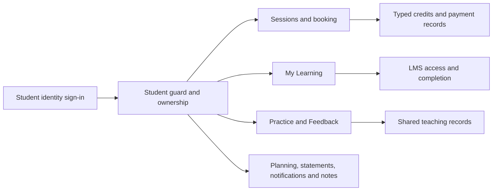

# Student Portal Copy Discovery and Implementation Report

Date: 9 October 2026 (Africa/Cairo)  
Status: **DISCOVERY COMPLETE — IMPLEMENTATION NOT STARTED**  
Approval: **Overall plan and student decisions S1–S5 pending**

The existing portal supports most of the supplied experience. The work should mainly update student-facing presentation around existing services. Additional emails, browser authorization, QA discovery, future Session Details and private-note wording need explicit decisions. No application code, schema, business/content record, dependency or configuration has been changed for this student assignment. Only this requested report and a sign-in review screenshot have been created.

The earlier website implementation is a separate, still-uncommitted baseline. Its approved financial corrections, public copy and Blog implementation must be preserved. This report does not authorize deployment or another financial-policy change.

## Sources and authority

- The [pasted task brief](<C:/Users/e/.codex/attachments/5ff5ecd2-bb6f-4a51-90f0-ed4f7df4b43c/Pasted text.txt>) is the user's request. Sections 7, 9 and 48 explicitly require discovery, a concrete plan and approval before implementation.
- [Student Copy.docx](<C:/Users/e/Desktop/ChatGPT Saved/Student Copy.docx>) is the editorial and UX source. All **897 paragraph blocks**, including its terminology table, were extracted and read. The file contains one table, no tracked insertions/deletions, no comments and no additional header/footer/footnote/endnote text parts.
- Document chat framing, sample names/dates/prices, placeholders and implementation imperatives are not permission to create records, change rights or introduce capabilities. Version labels and editorial directions are not student-facing copy.
- Current routes, controllers, policies, services, templates, clients, installed packages, test definitions and read-only local database results establish actual behavior.
- `LMS_IMPLEMENTATION_STATUS.md`, `LMS_FINAL_AUDIT.md`, `PRE_LMS_INVARIANTS.md`, `STAGE_2_STUDENT_TEACHING_EXPERIENCE_REPORT.md` and the relevant capability entries provide historical context. Their earlier production/test receipts are not fresh verification by this assignment. Latest LMS documentation records Stage 9 acceptance with provider/recovery limitations; an empty local course catalogue is not evidence that the LMS is missing.
- Repository guidance and the document-reading, Laravel, testing, Livewire, Tailwind and browser-review guidance apply. `.ai/rules` does not exist. No convention sweep, rule recording, delegation or new dependency is proposed.

## A. Current architecture and safety

### Runtime and source-control baseline

| Check | Current evidence and implication |
| --- | --- |
| Checkout | `C:/Users/e/Herd/ArabicwAbdallah` |
| Branch | `codex/public-copy-blog-v3`, HEAD `73e482d2e156eb5242a07f127f0ce62909829e9b` |
| Working tree | **71 modified tracked paths and 31 untracked paths** before this report was created; this report adds one untracked path, bringing that count to **32**. Existing paths belong to the previous website work or pre-existing reports. No student template/controller/LMS implementation edits were made for this assignment. Existing changes in Student services/models are the approved financial implementation. |
| Existing documents to preserve | `HOSTINGER_FIVE_PASS_DEPLOYMENT_REPORT.md`, `HOSTINGER_FIVE_PASS_PRODUCTION_PREFLIGHT.md`, `PRODUCTION_TYPED_ENTITLEMENT_MAPPING_PROPOSAL.md` remain pre-existing untracked files. |
| Isolation | Safe for read-only discovery. Do not begin student implementation in this mixed working tree. After approval, preserve the completed website work in a local snapshot, then create a dedicated `codex/student-portal-copy` branch or managed worktree based on that snapshot. Do not start from remote `main` and lose the uncommitted financial/public changes. |
| Deployment | Current branch has no upstream and no remote branch counterpart. No configured hooks path or repository deployment workflows were found; previous safety review found no active local deployment hook. Local unpublished edits do not initiate a remote release. Hosting-provider push/merge deployment settings were not inspected; treat every future push or deployment-branch merge as potentially consequential and forbidden for this task. |
| Other work | App inventory showed only this Codex chat active. The visible LMS Codex chat was not loaded, and there were no uncommitted LMS implementation paths. This cannot exclude an external editor or unseen worker; recheck status and overlap immediately before implementation. No other chat was messaged or interrupted. |
| Framework | PHP 8.4; Laravel **13.32.0**, Livewire **4.4.5**, PHPUnit **12.5.35**, Pint **1.32.1**, Larastan **3.12.2**, installed versions confirmed with Composer. Frontend follows the existing Blade/Tailwind/Alpine/Vite architecture. |
| Normal application | `APP_ENV=local`; MySQL connection to MariaDB **10.11.18**, database **bolt_landing**, localhost port **3307**. No production connection was used. |
| Test environment | `APP_ENV=testing`; MySQL/MariaDB **10.11.18**, **bolt_landing_test**, `127.0.0.1:3307`, verified through testing configuration and the read-only database information command. No inherited APP_ENV/DB_DATABASE/DB_URL override or cached configuration was present. |
| Mutation boundary | Discovery did not run tests, migrations, seeders, factories, verification emails, bookings or student mutations. Initial implementation/fixtures must target the dedicated test environment. Normal development-data changes require an explicit, bounded approval; section 5's test-only mutation rule remains authoritative. |

Any isolated preview must use a verified non-production/test database. An authenticated visit can synchronize notifications, and opening LMS content can record visits/progress; therefore discovery did not sign into an existing student or browse populated learning screens. A later owner walkthrough needs dedicated test fixtures, not alteration of the normal development students.

### How the portal works

The `/student` route group adds private/noindex headers. Login is a standard CSRF-protected form with throttling. Protected routes use the student guard, `StudentSessionContext` and `EnsureStudentAuthenticated`; learner-preview sessions cannot enter the student area. The canonical student must be verified, unsuspended and unmerged, and its absolute student session must still be valid.

Sign-in requires date of birth and at least two matching identifiers. Names use Unicode normalization and normalized punctuation/spacing; emails are trimmed/lowercased; phones use the existing international normalization/matching library. Login does not reveal individual match results. Sessions last 180 minutes. No password, OTP, PIN or social-login addition is needed.

`StudentPortalService` loads owned bookings, package projections, assigned forms and submissions. `StudentTeachingReadModel` loads student-visible homework/plans/resources/practice records, calculates genuine counters and next actions, and synchronizes deduplicated notifications during visits. Student booking uses signed owner-bound slots, canonical calendar locks, active typed-credit requirements, chronological package selection and an idempotent ledger debit. It confirms a booking immediately; it does not charge a card. Student booking does not have the public wizard's temporary-hold/review workflow.

My Learning uses the existing LMS access, content, progress, visit, personalized-assignment and teaching-timeline services. Access grants, publication, ownership, prerequisites, scheduled unlocks and completion requirements remain authoritative. Tutoring sessions, course lessons, homework and learning milestones are separate facts, not interchangeable counters.



The two notes systems have different boundaries. General `StudentBin` notes may be created by students or staff and read by authorized teaching staff. LMS `LessonNote` text is owner-scoped in the learner screens and is not returned by learner preview. Protected-video browser registrations supplement login; they are not portal-session authorizations.

### Read-only local dataset observations

| Fact | Observed result |
| --- | --- |
| Students / packages | 3 / 9 |
| LMS courses / private lesson notes | 0 / 0 |
| General Learning Notes | 5 |
| Questionnaires | Two genuine published forms: `short-form` and `long-form`; no QA questionnaire was identified in this catalogue. |
| Responses | One submitted current long-form response; one submitted short-form response retained on an older published version. No answers were read or rewritten. |
| Notifications | 20 total, 19 unread across the development dataset; these are aggregate counts, not a badge value for a particular student. |
| QA resource | Resource #1, `Synthetic Follow-up Access Guide`, published but hidden from the public catalogue. Assigned access remains separately authorized. |
| Active lesson formats | #2 Diagnostic, 60 minutes, package-credit configuration; #3 `Feature QA Lesson`, 60 minutes; #4 `Pass 4 Two-Hour QA Lesson`, 120 minutes. QA #3/#4 are hidden from public booking but still eligible for student booking/planning queries. Legacy #1 is inactive. |
| Typed units | `one_hour` / 1-hour sessions / 60 minutes; `two_hour` / 2-hour sessions / 120 minutes. Both are active. |

These are local observations only. No production data was queried. No synthetic record will be renamed into genuine content, deleted or hidden by a guessed name pattern.

## B. Page-by-page copy-to-code mapping and page tracker

All implementation rows below are **NOT STARTED**. A BLOCKED dependency identifies the particular approval needed, not a completed change. Verification in this table means source/test-definition review; fresh behavior and browser verification are planned after approval.

| Copy Master area | Current implementation | Required student-only work / dependency |
| --- | --- | --- |
| Global identity and navigation | `layouts.student` still renders “Egyptian Arabic Tutoring”; navigation has “Tutoring work”, “Statements” and “Educational Notes”. Profile/browser links are scattered between pages. | Arabic with Abdallah; the seven approved primary labels; Profile, Authorized Browsers and Sign Out as account actions. Reuse the current routes and responsive shell. |
| Sign In | DOB plus at least two identifiers, generic failure, normalization, throttling and session expiry already exist. | Welcome Back, approved labels/help/validation, privacy-preserving errors. Missing-input feedback can refer to the user's input; an unavailable-account reason must not reveal whether an account matched. Contact destination remains held. |
| Sessions | Owned upcoming/history, real next action, progress, forms and typed credit projections exist. Upcoming includes confirmed and genuine held/pending states. | Approved headings, honest empty/progress states, actual form-specific next actions, separate appointment/funding descriptions. Never label a held/pending booking Confirmed. |
| Booking | `/student/bookings/create`; type/date picker and slot buttons; direct confirmation; automatic earliest-expiring compatible package selection. | Approved credit-type, date/time, review and confirmation presentation using the same final endpoint. Do not add manual package selection or claim a temporary reservation. S3 blocks QA catalogue resolution. |
| Session Details | `/student/lessons/{booking}` is a gated post-lesson materials workspace, not an upcoming appointment details page. | **BLOCKED S4**: separate owner-scoped logistics page, preserving the materials policy. Show status/time/meeting/calendar/reschedule only when actually permitted. |
| Session History | Bookings include delivered/cancelled/no-show/rescheduled facts; completed is not mapped to cancelled. | Previous Sessions, clear genuine status labels, permitted materials/notes links and an intentional empty state. Preserve records and ledger consequences. |
| My Learning | Continue Learning, My Courses, For You and Completed already have projections and anchor navigation. | Approved introductions and empty states; no fabricated enrolments/progress. Source data can legitimately be empty. |
| Courses and lessons | Published accessible curriculum, rich text/images/files/resources/links/videos, quizzes, assignments and completion rules exist. | Approved course/lesson/result copy around the current gates. Do not invent recordings, AI, automatic transcripts/captions or change completion. |
| Recent Activity | `LmsTeachingTimeline` supplies owned delivered sessions, resource events and valid learning/evidence events. | Student-facing Recent Activity label and 12-hour local display. The shared staff component must retain its current staff presentation. |
| Practice & Feedback | `/student/learning` is the teaching page, confusingly titled “My learning”; it has real homework/plans/resources/practice records. | Rename the learner presentation, clarify the three-hub hierarchy and use approved supporting copy. No domain/class renaming. |
| Homework | assigned/in_progress/submitted/completed; student response, submit, staff feedback, due dates and protected resource links exist. | Not Started / In Progress / Submitted / Completed as accurate mappings. No separate Reviewed state should be invented. Completed homework remains locked. |
| Learning Plan | Shared plans/milestones exist. Diagnostic roadmap is not a distinct typed plan model. | Approved Learning Plan copy; keep a genuinely shared diagnostic roadmap/material separate. Do not infer its identity from a title or fabricate a roadmap tab. |
| Assigned Resources | Owned student-visible assignments and published resources; direct protected delivery and review state. | Approved headings and public-library link. **S3** governs QA discovery suppression; authorized direct access, homework/material references and history remain preserved. |
| Practice Focus | Student-visible error/practice records, corrections and active/improved/resolved statuses. | Practice Focus and friendly accurate status captions. Preserve the underlying teacher-managed states. |
| Feedback | Homework has real tutor feedback; LMS assessments have their own review/feedback. Lesson ratings are student-to-tutor feedback. | A functional Feedback section can summarize already-visible homework feedback and link to the LMS experience. Do not treat student ratings as tutor feedback or fabricate review dates. |
| Planning | Inclusive whole-day unavailability, preferred-period/waitlist records, withdraw/close actions and validation exist. | Approved labels/helpers/confirmations; retain “does not change existing lessons” and “does not book/use credit”. S3 applies to new-choice QA lesson types. |
| Statements & Receipts | Owned statements/receipts, CSV/XLSX/print and authoritative net-payment/refund/due/overpayment projections exist. | Approved learner terminology, gross/discount/net values where supported and honest overpayment. Shared admin view changes must be conditional on student context. |
| Notifications | Visit-synchronized facts, deduplication, owned read timestamps and real unread count. | Approved type-specific captions/actions, Read/Unread and badge presentation. Preserve read/history records and fix wrong lesson anchors without asserting that every historical notification is a fresh event. |
| Learning Notes | `/student/notes`; real title/body search, create, edit-own and staff-shared records. | Learning Notes / Notes, Search / Clear Search, genuine empty states; separate Shared With You / My Notes by creator metadata. **S5** forbids claiming these notes are private from staff. |
| Private Notes | Existing lesson-scoped LMS notes can be created/edited inside accessible lessons and read/deleted after access ends. No free-standing private title/search notebook exists. | **S5**: honest Private Lesson Notes presentation and qualified privacy wording. Do not add a general private notebook or change staff/backup rights. |
| Profile | Owned primary and verified secondary emails; no student endpoint for name/phone/DOB editing, primary-email switching or email removal. | Show supported student information accurately; readonly where no edit exists. Do not introduce identity edits. |
| Additional Emails | An authenticated verification-email challenge precedes creation of a trusted secondary address. | **BLOCKED S1**: immediate profile-only address versus retaining/deferring the verification flow. Existing trusted sign-in addresses must remain valid. |
| Authorized Browsers | Cookie/token identities and playback leases, labels, last-used/status and revoke/register actions. | **BLOCKED S2**: keep video scope and truthful removal effects. No automatic physical-device identification or account-session logout claim. |
| Questionnaires / Responses | Assigned, versioned forms, conditional validation, 700-ms autosave, submission revisions, frozen old versions and configurable edit-after-submit. | Approved wrapper/status/button copy; real save states and unsaved-change protection; preserve question keys, answers, versions and edit rules. No estimated duration is configured. |
| Package / Credit Details | Typed allocations and ledger summaries; exact new deadlines and protected legacy date-based expiry. | Friendly credits by type, actual eligible/expired state, student-only date/time formatting. Do not combine different credit types into interchangeable lessons or alter the approved clocks. |
| Global states | Native/Blade validation, flash messages, LMS unavailable views and conditional empty content. | Specific success/error/loading/saving/empty captions, accessible status regions and Arabic direction where appropriate. No fake retry, support, feedback or content action. |

## C. Compatibility matrix

A = copy only; B = copy plus minor presentation; C = behavior conflicts with the intended wording; D = partial support; E = missing capability; F = consequential claim needing a verified boundary.

| Area | Classification | Why |
| --- | --- | --- |
| Brand/navigation, existing status names | A/B | Presentation is outdated; the routes already exist. |
| Sign-in and profile | B/F | Identity flow supports the intended sign-in. Separate suspended/matched-account errors would disclose more than the current generic response. Identity editing is absent and not automatically authorized. |
| Sessions/history | B | Real state/history/progress; zero-heavy empty UI and technical terminology need adjustment. |
| Booking/credits | B/C | Credit type choice exists; package selection is automatic. Review presentation is missing, and QA formats are exposed. |
| Future Session Details | C/D/F | The existing materials permission deliberately excludes future lessons. Changing that policy would expand material access. |
| My Learning, Courses, Recent Activity | B | Real canonical access/progress/activity; empty local content is legitimate. Some timestamps still use 24-hour display. |
| Practice & Feedback | A/B | Real homework, plans, assigned resources, practice states and feedback. Reviewed is not a standalone tutoring-homework state. |
| Planning | B/C | Correct scheduling effects already exist; QA lesson choices still appear. |
| Statements/receipts/package display | B/F | Financial services are authoritative; generic discounts are not automatically proof of a diagnostic credit, nor is a package payment proof that a particular direct appointment is paid. |
| Notifications | B | Read/deduplication behavior is correct in source. Upcoming lesson notifications currently point at the history section. |
| Learning Notes | B/F | Shared/own authorship exists; authorized staff can read both. |
| Private lesson notes | B/F | Owner-only learner UI exists. Full-backup/system access means “visible only to you” is an excessive absolute claim. |
| General private notebook/search | D/E | Lesson-note functionality exists; a separate unrestricted private notebook with title/search is missing. Defer it. |
| Additional email addition | C/F | Current email-link verification and trusted-login effect conflict with the approved no-verification wording. |
| Authorized Browsers | C/F | Actual protected-video identity differs from the document's account-access/removal claim. |
| Questionnaires/global states | B | Existing behavior supports most wording; save-state honesty and wrapper text need bounded fixes. |
| New AI/transcripts/captions/unsupported capabilities | E / excluded | Do not create or advertise them. |

The five decisions below are prerequisites to their dependent work. Other conditional copy can follow the verified behavior without introducing new product capabilities.

## D. Copy and implementation conflicts

### S1 Additional email addresses and sign-in trust

**Intended:** “Add Another Email Address” immediately adds a profile address, with no verification-email/OTP/PIN/inbox workflow. The document expressly withholds a claim that it can be used to sign in.

**Actual:** `ProfileController::requestVerification` calls `StudentEmailService::requestVerification`. That creates a 15-minute, single-use, owner-bound challenge and sends a link. It does not create an additional profile email until the link is consumed. The resulting `StudentEmail` is a trusted sign-in identifier. Primary/secondary cross-account collisions are rejected, normalized secondary emails have a unique database index, and no student remove/make-primary endpoint exists. Both `trusted()` and `Student::verifiedEmails()` currently treat every secondary row as trusted; `verified_at` is NOT NULL.

**Impact:** Renaming Send Verification to Add Email Address would misrepresent behavior. Inserting an unverified row into the current trusted relation would change authentication eligibility.

**Recommended option A:** Implement immediate authenticated **profile-only contact addresses**, preserving all existing trusted addresses and their sign-in eligibility. The smallest candidate uses the existing email table with nullable `verified_at` for new contact-only rows and explicit non-null trust filters in every authentication/identity consumer. Existing timestamps and ownership stay unchanged. New addresses do not become sign-in credentials, do not replace the primary address and do not send mail. Retain normalization, cross-account uniqueness, canonical locking, throttling and audit identity. Check merge/privacy/resource identity consumers before choosing the final schema; never manufacture a verification timestamp. No new staff-verification workflow is implied. A rollback must not silently trust, delete or discard contact-only addresses.

**Option B:** Retain the existing verification-link flow with accurate wording. This requires an explicit exception to the supplied no-verification direction.

**Option C:** Defer student email addition; show existing addresses readonly. Do not leave a misleading Add button wired to verification.

**Approval needed:** S1 covers the schema/trust distinction, not changing the DOB/two-identifier authentication rule.

### S2 Authorized Browsers

**Intended:** A browser is authorized to access the student account; removing it prevents account access and requires another sign-in.

**Actual:** `VideoDeviceService` uses a cookie/token browser identity for protected videos. Registering/renaming/revoking is student-owned. Revocation marks the browser and its active playback leases revoked. Existing signed media links can survive briefly. It neither logs out the portal session nor prevents normal student navigation. A label defaults to My browser; no automatic Chrome/Windows identity is established. The list includes retained revoked records and is not specifically a list of “other” login sessions.

**Recommended option A:** Keep the approved Authorized Browsers heading but explain that it manages **protected-video playback**. Use true registration/last-used/status facts and accurate removal confirmation. Preserve portal login and the short-lived issued-link boundary. Show the current browser only when its owned token is actually matched; do not invent a physical-device name.

**Option B:** Add account-wide browser/session registration and revocation. That is a new security capability requiring a separate design, permission/session tests and approval; defer it from this copy task.

**Option C:** Retain the current video-specific page and defer the broader master wording.

### S3 QA discovery and genuine lesson formats

**Intended:** Students should see real assigned learning and lesson formats, with honest empty states rather than engineering fixtures.

**Actual:** QA SessionTypes #3/#4 remain active and appear in student package-booking and preferred-period choices. Public visibility controls deliberately do not revoke student rights. The only other active type is the Diagnostic, configured for a one-hour unit in the student flow. Public diagnostic booking independently creates direct-funded bookings; this finding does not show that public intake is broken. The genuine regular one-hour/two-hour replacement formats have not been confirmed. The published synthetic Resource #1 can appear through an authorized assignment despite being absent from the public catalogue.

**Impact:** Reusing `public_bookable` for student filtering could hide genuine private formats. Unpublishing the synthetic Resource or changing `student_visible` can remove authorized access. Relabelling QA records as real lessons would conceal their origin and alter historical presentation.

**Recommended option A:** Add narrow student-discovery controls, separate from publication/access: hide the explicitly identified QA lesson types from new self-service/planning choices and the synthetic Resource from new learner listings, while preserving historical appointments, assignments, balances and authorized direct delivery. Default all other records to visible. Do not filter by guessed substrings. Confirm genuine regular lesson-format records before replacing the QA choices; the existing one-hour/one-unit and two-hour/one-unit bindings are the recommended credit requirements, but new record titles/eligibility and financial metadata need owner confirmation. Do not change package prices or credit types. If no genuine compatible format exists, show an honest unavailable state and arrange the lesson through the existing tutor conversation.

**Option B:** Leave the current local QA choices available for engineering and defer the clean student catalogue. This does not satisfy final student discovery acceptance.

**Option C:** Segregate the owner walkthrough into test fixtures and defer normal-development catalogue changes. This preserves all existing development data and can be combined with option A's implementation/test coverage. No normal-development record update is authorized merely by this discovery report.

Questionnaire inspection found the genuine short/long forms, not QA forms. No blanket questionnaire removal, financial cleanup, notification deletion or course hiding is proposed. Unknown synthetic teaching records require an explicit inventory/owner decision, not automated deletion.

### S4 Appointment details versus post-lesson materials

**Intended:** View Session should work for an upcoming lesson, with actual time/status, gated meeting details, calendar and eligible rescheduling.

**Actual:** `LessonWorkspacePolicy::viewLessonWorkspace` only permits a completed owned booking or an owned confirmed booking whose end time has passed. It intentionally protects lesson materials. The current workspace shows dates/status/materials; it is not an upcoming logistics page.

**Recommended option A:** Add a small owner-scoped **Session Details** page under the existing student booking area. Reuse facts already shown on the Sessions dashboard, the meeting reveal service, calendar generation and reschedule eligibility. Future appointment logistics become navigable without changing the materials gate. Show a materials/notes action only when the current policy permits it. Foreign, suspended and unverified access remains denied. Payment information must describe actual funding: Covered by a lesson credit where established; payment arranged separately where no per-appointment recorded-payment fact exists. Do not infer payment from Confirmed.

Calendar actions are limited to appropriate confirmed appointments, must preserve meeting reveal and canonical UTC, and must not expose another student's bearer token. No cancellation/refund rule changes are included. Student-only presentation must preserve existing public calendar behavior.

**Option B:** Keep logistics within Sessions and defer the standalone page; show existing material-workspace links only when allowed. Adjust the master actions honestly.

**Option C:** Relax the material-workspace gate to let students open future materials. Not recommended: that changes an existing permission boundary and is unnecessary for logistics.

### S5 Learning Notes and Private Notes

**Intended:** Learning Notes can distinguish shared and student-created work; a Private Notes claim is conditional on verified privacy.

**Actual:** `StudentBin` stores creator type and supports shared/own display, but Admin/Assistant can read the general notes and Super Admin can moderate them. Students edit their own notes and have no general-note delete route. LMS lesson notes are owner-scoped in learner queries/actions; staff preview does not return their text. They are created/edited inside accessible lessons, with owner read/delete retained after course expiry. The full database-backup facility includes database text and is accessible to authorized system operators. The notes are not established as end-to-end encrypted.

**Recommended option A:** Keep **Learning Notes** and **Private Lesson Notes** separate, with existing rights intact. Explain that general notes can be shared with teaching staff. Use a bounded private-note caption, such as “These lesson notes aren't shown to other students or teaching staff in the learning screens.” Do not publish the absolute “visible only to you” claim. Preserve backup, merge/erasure and moderation behavior.

**Option B:** Defer the privacy sentence and use only the accurate Private Lesson Notes heading/description and existing capabilities.

**Option C:** Introduce a general private notebook or stronger encryption/admin-exclusion guarantee. That is a new feature/security design, outside the recommended copy implementation.

### Other conflicts resolved by following existing facts

- **Credit choice:** Present lesson-credit type selection and automatic earliest-expiring compatible package use; do not promise manual package choice or conversion between one-hour/two-hour units.
- **Review/hold:** A client-side review can reuse the current signed slot/final endpoint. Times may change until confirmation; do not borrow the public wizard's hold guarantee.
- **Homework:** Submitted is real. Reviewed is not a separate tutoring status. Completed and actual tutor feedback are meaningful independent facts.
- **Feedback direction:** Tutor homework/LMS review comments belong in the coaching Feedback experience. Student-to-tutor lesson ratings remain distinct.
- **Roadmap:** A diagnostic roadmap can be a genuinely shared material, but is not automatically a LearningPlan with a distinct system type. Do not infer it from a title.
- **Questionnaires:** Display Not Started / In Progress / Completed according to genuine submission state. A retained submitted old-version response stays viewable, with Update Available separate from missing answers. Next-action wording must identify the actual form rather than always saying Finish Your Learning Profile. No assignment/version rule change is proposed.
- **Discounts/payments:** Show stored gross/discount/final/net/refund/due/overpayment values. A generic discount is not automatically a diagnostic credit. “Payment Recorded” requires an actual applicable record, not a confirmed appointment or predicted installment.
- **Time:** Student sessions already use AM/PM. LMS cards, notes, timeline and statements have remaining 24-hour displays. Shared components require student-specific formatting so staff preferences/export contracts remain intact. New package timestamps need an exact deadline/timezone, not only the master example's date.
- **Contact:** The earlier approved hold on unverified contact/social destinations persists. Use truthful help text through the existing tutor conversation; do not invent a working Contact Abdallah link.

## E. Missing or incomplete capabilities to defer

| Item | Actual support | Recommended disposition |
| --- | --- | --- |
| Free-standing private notebook with title/search | Only lesson-linked LMS private notes exist. | Defer; keep the real private lesson-note experience. |
| Portal-wide browser/session revocation | Protected-video browser identities/leases exist. | Defer account/session expansion; use accurate video wording. |
| Manual package selection during booking | Compatible package selection is automatic. | Preserve it and adjust the explanation. |
| Generic Reviewed homework state | Submitted/completed plus actual feedback exist. | Use supported labels; no new workflow state. |
| Separate typed diagnostic roadmap tab | Shared materials and generic plans exist. | Display real shared material only; no invented model/tab. |
| Profile identity edit, primary-email switch, additional-email removal | No student endpoints implement these. | Keep readonly/defer controls. |
| Questionnaire duration estimate | No configured/calculated duration identified. | Omit the estimate. |
| AI tutor, automatic transcript/captions, guaranteed recordings | Not established by supported learner content. | Excluded. |
| New French/German portal copy | Only English master supplied. | English-first learner wording with correct language tags; no invented translations. |
| Confirmed student support URL | Still held from the website task. | Keep the action unavailable until an approved destination exists. |

Existing access, course progress/completion, personalized learning, LMS assessment feedback and activity projections are preserved features, not deferred placeholders. Live provider certification remains an inherited LMS limitation; this task does not certify Bunny or create video content.

## F. Safe copy and presentation changes after overall approval

Replace the student brand and navigation labels; clarify the three learning hubs; map genuine statuses to friendly captions; use the approved headings, helper text and contextual success messages; distinguish empty data from unavailable content; make search controls say Search/Clear Search; add small responsive/focus/direction improvements; and complete 12-hour student display through the existing timezone architecture.

These changes need no domain/class rename, new authentication factor, price/policy change, content generation or LMS architecture rewrite. Use student context in shared statement/note/planning/timeline views. Keep public and admin presentation unchanged. Show real supporting feedback only, and preserve all historical data.

## G. Relevant defects and risks found

The first three findings below are established by code paths, not freshly executed reproductions. Targeted tests/browser reproductions must precede fixes after approval. They are included in the bounded plan rather than disguised by copy.

| ID | Finding and evidence | Proposed bounded treatment |
| --- | --- | --- |
| SP-01 | Questionnaire input queues save after 700 ms. The status changes to Saving only when the request begins, and no pending-change navigation guard is present in the questionnaire client. Leaving before the debounce/request completes can lose the last edit while the UI still appears saved. | Mark dirty/pending immediately; show actual saving/saved/error; guard unsaved navigation and preserve final-submit synchronization. No browser storage of sensitive answers, version rule change or new dependency. |
| SP-02 | Booking's Show available times button is disabled when the currently selected type has zero compatible credits. Another funded type can still exist, but changing the select alone cannot re-enable that server-rendered button. | Permit type-selection refresh when another genuine compatible option exists; keep unfundable final confirmation disabled and rechecked server-side. |
| SP-03 | Every lesson notification currently links to `#history-title`, including future confirmed appointments that are in Upcoming Sessions. | Use an owner-scoped Session Details destination for new events after S4; give retained generic lesson notifications a sensible Sessions fallback. Preserve IDs/read state/history. |
| SP-04 | The common test base verifies database vendor/version but does not itself reject a normal-development database with the same engine. Environment variables can override XML configuration. Current dedicated target is correctly verified. | Harden the test-only preflight before database-refresh traits; independently confirm connection/name before every mutating command. Do not weaken the engine check or run destructive commands on development data. |
| SP-05 | Student slot listing uses calendar availability, while the final booking service separately enforces owned unavailability. A selected slot can therefore be rejected because of the student's recorded period. | Reproduce before treating it as a confirmed UI defect. If verified, mirror the existing exclusion in learner display only; do not alter availability, notice, concurrency or credit rules. Include this bounded alignment in plan approval. |

**Checked and not identified as current defects:** completed bookings are explicitly mapped to delivery and a confirmation GET does not cancel them; notification synchronization uses insert-or-ignore and does not reset `read_at`; overpayment has an authoritative backend projection. These behaviors need preservation tests, not invented fixes.

**Separate shared-calendar observation:** `IcsGenerator` emits `STATUS:CONFIRMED` regardless of the booking's actual state. The token endpoint can generate a calendar for non-confirmed history. This is a shared public/calendar issue; do not silently modify it during this student-only assignment. Keep portal calendar actions limited to valid confirmed appointments and report any broader correction for a separate approval.

QA visibility, verification-email behavior, post-lesson material restrictions and browser playback scope are decisions/configuration boundaries, not automatically bugs. No destructive cleanup has been performed.

## H. Recommended implementation sequence

### Stage 0 Preserve the baseline and establish isolation

After overall approval, capture the current diff and check for concurrent LMS work again. Preserve the completed website application changes as a **local snapshot** on its existing branch, excluding the three pre-existing production documents and unrelated files. Create a dedicated `codex/student-portal-copy` branch in an isolated managed worktree based on that local snapshot. Keep the original checkout and its development dataset intact. Do not push the snapshot or student branch, merge, deploy or invoke production infrastructure.

Prepare an isolated Herd preview with test-only configuration and `bolt_landing_test`; use the existing Herd tooling rather than starting an application server. Do not copy real student data into the test database. Confirm runtime connection/name before every migration, factory or test refresh, and harden the test-only database-name guard before destructive tests. Database suites and interactive test-data walkthroughs run serially. All additional test fixtures and any approved initial DDL target the dedicated test database. Normal-development DDL/data changes are not implied by this plan; any later exception needs explicit approval and a bounded preservation comparison.

### Stages 1–10

| Stage | Work | Dependencies / acceptance |
| --- | --- | --- |
| 1 Shared student foundation | Brand, seven primary navigation labels, account actions, terminology, student-only AM/PM and accessible global feedback/empty states. | Existing routes/components; no public/admin rewrite. Check shared branches and English language tagging. |
| 2 Sign In and account | Approved login/profile copy; retain identity normalization, two-match rule, generic failures and existing readonly identity fields. Implement the selected email behavior and truthful browser page. | S1/S2; contact destination remains held. Preserve existing trusted aliases and every security boundary. |
| 3 Sessions and booking | Dashboard/progress/credits/history copy; honest status/funding; type-picker fix, approved review presentation and selected Session Details solution. | S3/S4. No manual package selection, new hold or policy change. Material permissions stay unchanged. |
| 4 My Learning | Approved four sections, Recent Activity, course/lesson/result/empty/unavailable copy and student timestamps. | Preserve canonical access, prerequisites, completion, evidence, provider configuration and private delivery. No new learning content. |
| 5 Practice and Feedback | Homework, Learning Plan, Assigned Resources, Practice Focus and a genuine feedback summary. | Use current shared/owned records; no fake Reviewed state or roadmap content; S3 for QA listings. |
| 6 Planning | Unavailability and Preferred Lesson Periods copy, date helpers, statuses/actions and bounded slot-display alignment if SP-05 is reproduced. | Preserve full-day timezone semantics, actual validation, existing appointments, credit balance and booking rules. |
| 7 Statements and receipts | Student-only headings, summaries, discount/net-payment/refund/overpayment explanations, existing exports and date display. | Financial services and prices unchanged; exact new deadlines and legacy dates preserved; staff view/export behavior protected. |
| 8 Notifications and notes | Genuine unread badges/read states, corrected destinations, Learning Notes authorship/search/create/edit and private lesson-note wording. | S4/S5; preserve notification/note history, staff rights and resource ownership. No generic private notebook. |
| 9 Questionnaires | Approved wrapper labels, actual form-dependent actions, response states and SP-01 save/navigation protection. | Stable keys, version freezing, retained responses and edit-after-submit restrictions remain. No new questionnaire version is needed for student-only wrapper copy. |
| 10 Full student journey | Dedicated-test HTTP/security/data checks, safe browser workflows, mobile/tablet/desktop/Arabic review, build/format/static comparison and report updates. | Actual receipts required before any VERIFIED COMPLETE status. Remaining owner holds/provider limits explicitly recorded. No production task. |

Routine presentation choices can proceed after overall approval. Reopen approval only for a new consequential choice outside the selected decisions and this bounded plan. Do not add a dependency, policy exception, learner capability or data cleanup to make copy easier to implement.

### Proposed verification

These tests/builds have **not been run for this student assignment**. They are the acceptance plan after approval. Prefer the narrowest relevant file/filter while developing, then the documented normal current-schema suite. Run dedicated worker/concurrency cases separately, not interleaved with the normal suite or a browser walkthrough.

| Area | Existing tests and required additions |
| --- | --- |
| Authentication/account | StudentAuthenticationTest, StudentBackfillAndIdentityTest, StudentSecondaryEmailTest, RateLimitingTest and SessionInactivityAndCookieRefreshTest. Confirm sufficient/insufficient/invalid identities, generic failures, cooldown, expired/suspended sessions. S1 adds immediate profile association, no outgoing mail, no new sign-in trust, retained verified-alias login, duplicate/cross-account collision and merge/privacy handling. |
| Booking/rights | StudentCreditBookingTest, TypedEntitlementsTest, StudentReschedulingTest, ReschedulePresentationTest, AvailabilityTest, BookingHoldAuthenticationTest and FinancialTimingCorrectionTest. Add two-type selection recovery, unfundable confirmation denial, approved QA visibility and owner-scoped details/material separation. Assert one exact typed debit and preserved timestamps/history on retry/reschedule. |
| Session states | FormsEngineTest status cases, BookingLifecycleAndPolicyCutoffTest and LessonWorkspaceTest. Confirm completed/no-show/cancelled/rescheduled rendering, repeated private status visits, meeting reveal and calendar eligibility. No materials on a future logistics page. |
| Learning/feedback | StudentLearningTest, LmsAccessOperationsTest, LmsLearningEvidenceTest, LmsWatchProgressTest, LearningPreviewTest and TutoringLearningIntegrationTest. Verify real empty/populated hub sections, owner/foreign access, progress/completion, assignment feedback and unavailable/locked content. Keep provider calls mocked under the existing boundary. |
| Coaching/resources/planning | StudentTeachingExperienceTest, LessonWorkspaceTest, ResourceSafeReplacementTest and relevant scheduling cases in BusinessOperationsControlsTest/V5RemediationModuleTest. Test homework supported/locked states, shared plan/resource/practice visibility, review, inclusive dates and preserved existing appointments/credits. |
| Financial display | StudentLedgerTest, CashierBillingReconciliationTest and statement/export cases. Compare rendered amounts to services, including partial/full payments, refunds, overpayment and generic discounts; preserve CSV/XLSX and staff branches. |
| Notifications/notes | StudentTeachingExperienceTest, LmsLifecycleIntegrationTest, BinAuthorizationTest and StudentLearningTest. Read/unread deduplication and destination checks; shared/own-note edit permissions; private lesson-note owner isolation and post-expiry read/delete; staff-preview exclusion. |
| Questionnaires | FormsEngineTest, FeatureExpansionTest and student form cases. Validate autosave/submit, conditional required inputs, unknown/foreign records, frozen versions, retained completed responses and allowed/locked editing. Add browser/JS evidence for pending, saved, failure and rapid navigation; HTTP autosave tests alone cannot prove the navigation guard. |
| Presentation | Add only meaningful student contracts to dedicated PHPUnit tests, plus safe real-browser review. Check 12-hour formatting across Cairo DST and the student's timezone, exact package deadline display, Arabic/mixed direction, focus/keyboard, wrap/overflow, validation, empty states and working links. |

Representative commands after approval:

```text
php artisan --env=testing env --no-interaction
php artisan --env=testing db:show --database=mysql --json --no-interaction
php artisan test --compact tests/Feature/StudentAuthenticationTest.php
php artisan test --compact tests/Feature/StudentSecondaryEmailTest.php
php artisan test --compact tests/Feature/StudentCreditBookingTest.php
php artisan test --compact tests/Feature/StudentReschedulingTest.php
php artisan test --compact tests/Feature/StudentTeachingExperienceTest.php
php artisan test --compact tests/Feature/StudentLearningTest.php
php artisan test --compact tests/Feature/BinAuthorizationTest.php
php artisan test --compact tests/Feature/FormsEngineTest.php
php artisan test --compact --exclude-group=intermediate-schema --filter='^(?!.*Concurrency)'
php vendor/bin/phpunit -c phpunit.concurrency.xml --filter='(StudentLearningConcurrencyTest|TutoringLearningConcurrencyTest|BusinessLifecycleConcurrencyTest)'
npm run build
php vendor/bin/pint --dirty --format agent
php -d memory_limit=1G vendor/bin/phpstan analyse --memory-limit=1G --no-progress --error-format=json
git diff --check
```

Verify the normal-suite filter against the current dedicated worker-class inventory before using it; do not filter away failing student cases. The documented `intermediate-schema` group is a separate historical-schema exercise. Do not reinterpret earlier all-files failures as confirmed student defects without the correct test isolation/selection.

The preceding website task's receipts remain useful context: 241 scoped tests passed, a later 55-test archive/Blog run passed, and the all-files run had 1,342/1,468 passes with the same 126 unsuccessful cases on the original source. Static comparison was 250 existing issues versus 255 originally, zero new. These are **prior-task receipts**, not newly executed student-copy verification. Establish a fresh baseline in the isolated student environment and keep its limitations visible.

## I. Owner decisions required

Overall implementation approval is still required. The recommendations below form a concrete default; none has been applied.

| Decision | Question | Recommended answer |
| --- | --- | --- |
| S1 Additional emails | Should Add Email Address immediately attach a profile-only contact address, retain email-link verification, or be deferred? | **Immediate profile-only addition, not a sign-in credential.** Preserve existing trusted aliases; no verification email/OTP/PIN. Approve the minimal nullable/trust-consumer changes described in D. |
| S2 Authorized Browsers | Should this page keep its actual video-playback boundary or gain account-wide session revocation? | **Keep protected-video scope and use truthful copy.** Defer account-session expansion. |
| S3 QA discovery and formats | May known QA entries be hidden from new student discovery without revoking historical/assigned access, and which genuine regular lesson formats should replace the QA choices? | **Approve narrow discovery controls and preserve rights.** Confirm real one-hour/one-unit and two-hour/one-unit package lesson records if both are intended; hold new normal-development records/financial metadata until confirmed. If no genuine replacement exists, use an honest unavailable state. |
| S4 Session Details | May we add an owner-scoped appointment-logistics page while keeping future lesson materials restricted? | **Yes: separate logistics from the post-lesson materials gate.** Reuse real meeting/calendar/reschedule/funding facts; no policy change. |
| S5 Notes and privacy | Should Learning Notes retain staff sharing, and Private Lesson Notes retain their narrower existing scope with a qualified privacy sentence? | **Yes.** Preserve both systems/rights, omit the absolute only-you claim and defer a general private notebook/encryption redesign. |

The overall plan also includes reproducing and fixing SP-01–SP-03, test-environment guard hardening, and SP-05 only if its display mismatch is reproduced. These are bounded coherence/safety fixes; they do not authorize policy, price, identity-score, material-permission or completion-rule changes. The separate shared-calendar issue is recorded, not included as a public-system fix.

No new support/contact destination, real course, resource asset, questionnaire question, package price or learning content has been invented. The workbook/public contact holds from the earlier task remain untouched.

## Discovery commands and actual verification status

Executed read-only inspection included:

- `git branch --show-current`, `git status --short/--porcelain`, `git diff --name-only`, `git for-each-ref --format='%(refname:short)|%(upstream:short)' refs/heads`, `git ls-remote --heads origin refs/heads/codex/public-copy-blog-v3`, rules/configuration-cache/index-lock checks.
- `php artisan env --no-interaction`, `composer show --direct --no-ansi`, package manifests and current test configuration.
- `php artisan route:list --path=student --except-vendor --json`, followed by direct inspection of the complete student route group and relevant methods/policies.
- `php artisan --env=testing env --no-interaction`, `config:show database.connections.mysql.database`, `.host`, `.port`, and `php artisan --env=testing db:show --database=mysql --json --no-interaction`. These confirmed the dedicated test identity without migration/refresh/seeding.
- Registered Laravel Boost DatabaseQuery/GetAbsoluteUrl tools, invoked through `boost:execute-tool`, for local database identity, non-personal counts, lesson/resource/form metadata, response-version counts and email schema/index information. Only SELECT statements were used. A testing-environment Boost call was unavailable because that namespace is not registered there; the read-only native database information command supplied the test preflight instead. Exploratory missing-field/path searches were corrected and are not application test failures.
- Complete Word text/table extraction through bundled Python/OOXML, plus code, relevant documentation and existing test-definition review.
- Local browser GET of [Student Sign In](http://arabicwabdallah.test/student/login), resolved through Boost. The current title/brand is visibly Egyptian Arabic Tutoring, with the correct DOB/two-identifier instruction. No identity entered, no sign-in/form submission and no populated student visit occurred. [Baseline screenshot](C:/Users/e/.codex/visualizations/2026/10/08/01a11c59-4828-79c3-9bb8-c9a4ceeb8f42/student-portal-sign-in-baseline.jpg); the temporary tab was closed.
- Final branch/status checks retained the original HEAD, 71 modified tracked paths and the original 31 untracked paths plus this report. `git diff --check` exited successfully with no whitespace errors in the tracked diff; existing line-ending notices were emitted. This check does not include the untracked report and is not an application test.

**Fresh automated tests: not run in discovery. Build/static analysis/formatter: not run for this assignment because application code is unchanged. Post-login browser journeys: not yet exercised.** Current claims distinguish inspected support from future runtime acceptance. No Student Portal area is marked IMPLEMENTED or VERIFIED COMPLETE.

### Source anchors for review

| Concern | Current source |
| --- | --- |
| Student routes | [web.php](C:/Users/e/Herd/ArabicwAbdallah/routes/web.php:113) |
| Shell / account | [student layout](C:/Users/e/Herd/ArabicwAbdallah/resources/views/layouts/student.blade.php), [AuthController](C:/Users/e/Herd/ArabicwAbdallah/app/Http/Controllers/Student/AuthController.php), [StudentSessionContext](C:/Users/e/Herd/ArabicwAbdallah/app/Domains/Students/Services/StudentSessionContext.php) |
| Email decision | [StudentEmailService](C:/Users/e/Herd/ArabicwAbdallah/app/Domains/Students/Services/StudentEmailService.php), [ProfileController](C:/Users/e/Herd/ArabicwAbdallah/app/Http/Controllers/Student/ProfileController.php), [Student model](C:/Users/e/Herd/ArabicwAbdallah/app/Domains/Students/Models/Student.php:71) |
| Booking/presentation | [student BookingController](C:/Users/e/Herd/ArabicwAbdallah/app/Http/Controllers/Student/BookingController.php), [booking view](C:/Users/e/Herd/ArabicwAbdallah/resources/views/student/bookings/create.blade.php), [StudentBookingService](C:/Users/e/Herd/ArabicwAbdallah/app/Domains/Students/Services/StudentBookingService.php) |
| Material restriction | [LessonWorkspacePolicy](C:/Users/e/Herd/ArabicwAbdallah/app/Policies/LessonWorkspacePolicy.php:16), [LessonWorkspaceController](C:/Users/e/Herd/ArabicwAbdallah/app/Http/Controllers/Student/LessonWorkspaceController.php) |
| Shared teaching / notifications | [StudentTeachingReadModel](C:/Users/e/Herd/ArabicwAbdallah/app/Domains/Students/Services/StudentTeachingReadModel.php), [StudentNotificationService](C:/Users/e/Herd/ArabicwAbdallah/app/Domains/Students/Services/StudentNotificationService.php) |
| My Learning / access / progress | [StudentLearningService](C:/Users/e/Herd/ArabicwAbdallah/app/Domains/Lms/Services/StudentLearningService.php), [LmsAccessService](C:/Users/e/Herd/ArabicwAbdallah/app/Domains/Lms/Services/LmsAccessService.php), [LmsProgressService](C:/Users/e/Herd/ArabicwAbdallah/app/Domains/Lms/Services/LmsProgressService.php) |
| Notes boundary | [StudentBinPolicy](C:/Users/e/Herd/ArabicwAbdallah/app/Policies/StudentBinPolicy.php), [StudentLearningStateService](C:/Users/e/Herd/ArabicwAbdallah/app/Domains/Lms/Services/StudentLearningStateService.php), [LmsPreviewService](C:/Users/e/Herd/ArabicwAbdallah/app/Domains/Lms/Services/LmsPreviewService.php), [BackupService](C:/Users/e/Herd/ArabicwAbdallah/app/Domains/System/Services/BackupService.php) |
| Browser boundary | [VideoDeviceService](C:/Users/e/Herd/ArabicwAbdallah/app/Domains/Lms/Services/VideoDeviceService.php), [VideoDeviceController](C:/Users/e/Herd/ArabicwAbdallah/app/Http/Controllers/Student/VideoDeviceController.php) |
| Questionnaire save risk | [questionnaire view/client](C:/Users/e/Herd/ArabicwAbdallah/resources/views/student/forms/show.blade.php), [FormSubmissionService](C:/Users/e/Herd/ArabicwAbdallah/app/Domains/Forms/Services/FormSubmissionService.php), [FormAssignmentService](C:/Users/e/Herd/ArabicwAbdallah/app/Domains/Forms/Services/FormAssignmentService.php) |
| Financial presentation | [FinancialStatementService](C:/Users/e/Herd/ArabicwAbdallah/app/Domains/Students/Services/FinancialStatementService.php), [shared statement view](C:/Users/e/Herd/ArabicwAbdallah/resources/views/admin/billing/statement.blade.php) |
| Test safety | [TestCase](C:/Users/e/Herd/ArabicwAbdallah/tests/TestCase.php), [phpunit.xml](C:/Users/e/Herd/ArabicwAbdallah/phpunit.xml), [concurrency configuration](C:/Users/e/Herd/ArabicwAbdallah/phpunit.concurrency.xml) |

## Remaining issues and approval checkpoint

- All student implementation is NOT STARTED; S1–S5 and overall plan approval are pending.
- Genuine regular package lesson formats and any normal-development catalogue update need owner confirmation.
- Unverified support destinations, a general private notebook, account-wide browser revocation, extra identity editing and new learning content remain held/deferred.
- Future verification must cover browser behavior, data preservation and current permissions, with actual test/build receipts. Earlier LMS/public evidence cannot substitute for it.
- Production, the public marketing pages, admin presentation, financial/expiry policy and ongoing LMS architecture remain outside this implementation.

**I am waiting for your approval before implementation.**
